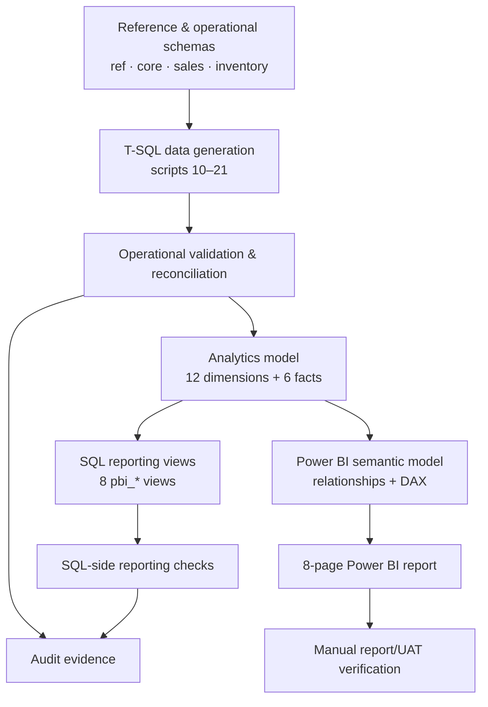
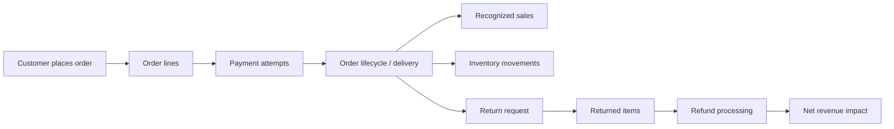
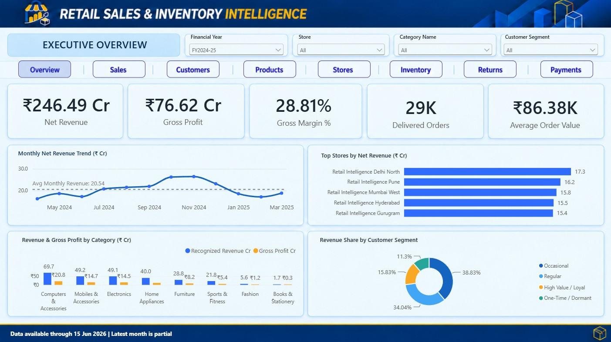
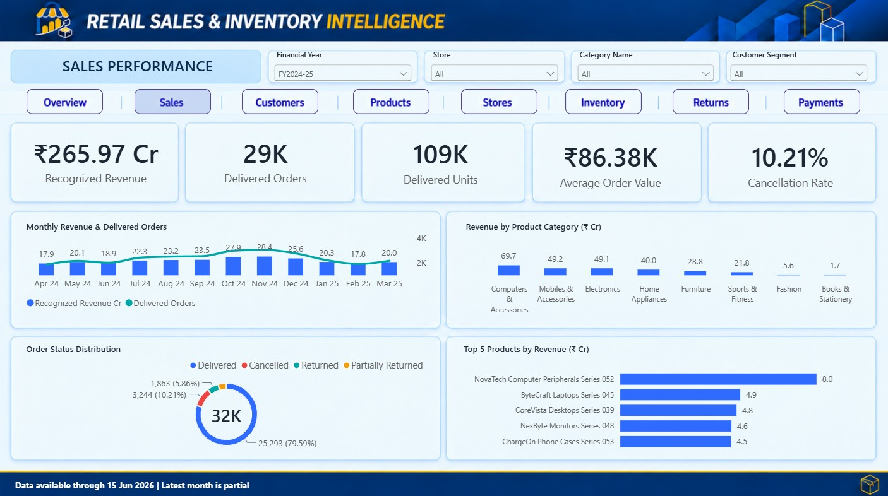
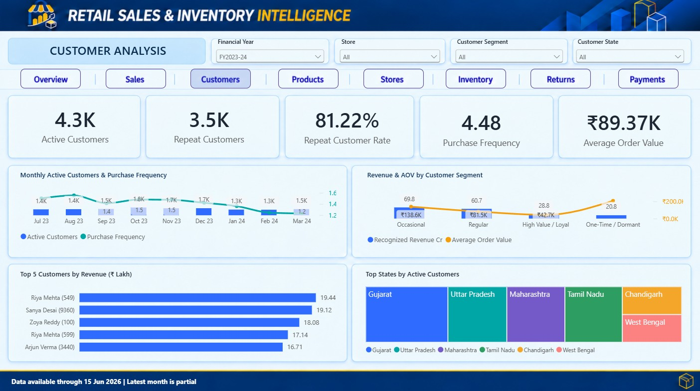
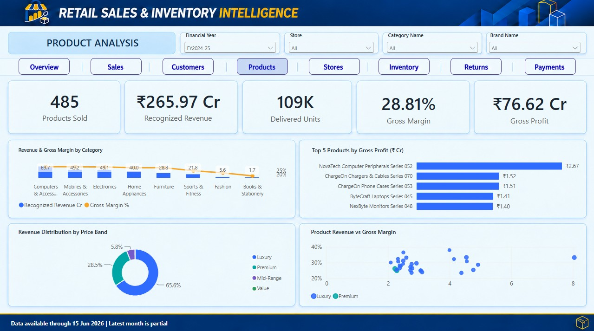
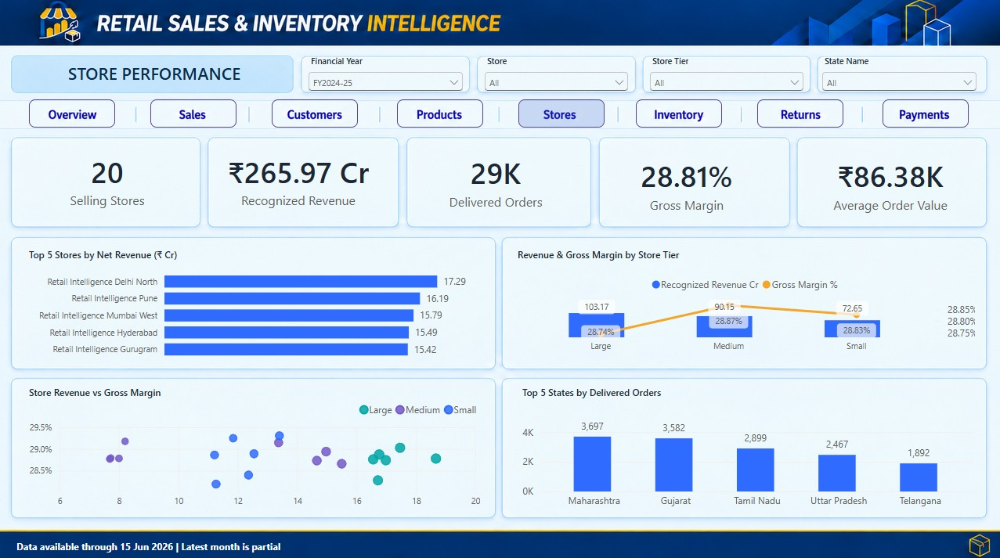
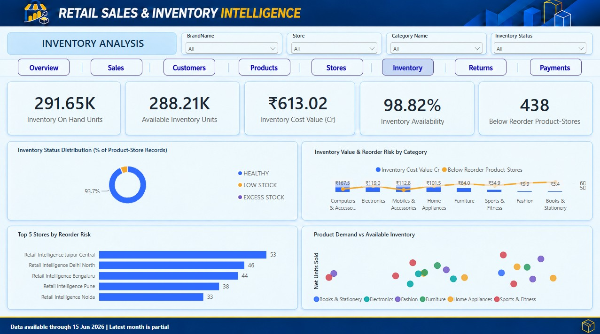
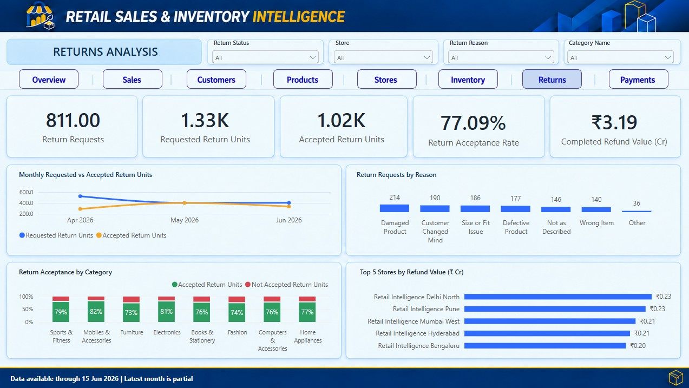
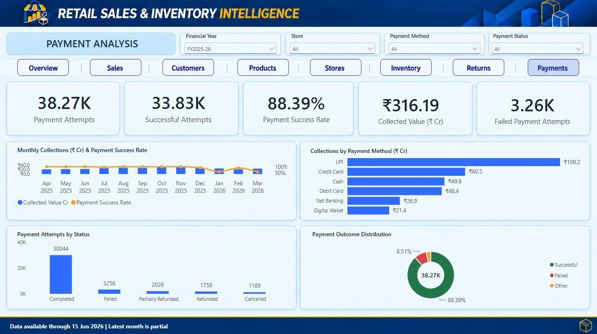

# Retail Sales & Inventory Intelligence Platform

### End-to-End Retail Analytics | SQL Server • T-SQL • Data Modeling • Power BI • DAX • Quality Assurance

**A portfolio case study that follows retail transactions from operational records to executive decisions.**

> **Data disclosure:** All retail data in this project is synthetic and generated with T-SQL. This is an independent learning/portfolio project, not a production deployment or an analysis of a real retailer's confidential data.

## Contents

1. [Executive summary](#1-executive-summary)
2. [Business case and stakeholders](#2-business-case-and-stakeholders)
3. [Project scope and outcomes](#3-project-scope-and-outcomes)
4. [Technology and architecture](#4-technology-and-architecture)
5. [Data model and volumes](#5-data-model-and-volumes)
6. [Retail transaction lifecycle](#6-retail-transaction-lifecycle)
7. [Power BI dashboard walkthrough](#7-power-bi-dashboard-walkthrough)
8. [Metric definitions and interpretation](#8-metric-definitions-and-interpretation)
9. [SQL implementation: all 41 scripts](#9-sql-implementation-all-41-scripts)
10. [Data quality and validation](#10-data-quality-and-validation)
11. [Performance engineering](#11-performance-engineering)
12. [Business insights and decision framework](#12-business-insights-and-decision-framework)
13. [Reproduction and safe execution](#13-reproduction-and-safe-execution)
14. [Repository structure](#14-repository-structure)
15. [Documentation and evidence](#15-documentation-and-evidence)
16. [Design choices and limitations](#16-design-choices-and-limitations)
17. [Interview discussion points](#17-interview-discussion-points)
18. [Author and project status](#18-author-and-project-status)

---

## 1. Executive summary

A multi-store retailer generates information across orders, customers, products, payments, refunds, and inventory. These records cannot safely be joined into a single dashboard without first resolving different transaction grains, date definitions, and business rules.

This project implements a **SQL Server operational database**, populates it with **reproducible synthetic retail activity**, transforms that activity into a **dimensional analytical model**, applies **data quality and reconciliation controls**, and presents the results through an **eight-page Power BI report**.

The emphasis is not simply on charts: the project demonstrates **data integrity, consistent KPI definitions, business storytelling, repeatable SQL delivery, and the separation of automated SQL checks from manual report acceptance**.

### At a glance

| Capability | Project implementation |
|---|---|
| Database | Microsoft SQL Server, `RetailIntelligenceDB` |
| Schemas | `ref`, `core`, `sales`, `inventory`, `audit`, `analytics` |
| Source data | Synthetic data generated using T-SQL |
| SQL delivery | **41 SQL files**: master orchestrator `00` + scripts `01–40` |
| Tables | **43** total: 25 operational/reference/audit + 12 dimensions + 6 facts |
| Sample business footprint | 20 stores, 100 employees, 10,000 customers, 50 suppliers, 500 products |
| Transaction scale | 100,000 orders; 300,000 order items; 108,000 payment attempts |
| Reporting | Eight Power BI pages; page-specific slicers and DAX |
| SQL reporting layer | Eight `analytics.pbi_*` reporting views |
| Quality controls | Model, data quality, reporting-view, and deployment checks |
| Primary audience | Executives, sales, finance, product, customer, store, and inventory teams |

*Figures above reflect the supplied implementation and project validation records; this README does not claim that the database was re-executed during documentation review.*

## 2. Business case and stakeholders

### The problem

Retail management needs to know whether sales growth translates into recognized revenue and profit, which customers and products contribute most, where stock is exposed to risk, and how failed payments, returns, and refunds affect the business.

Operational systems record different events at different grains: an order may have multiple items, a payment may have multiple attempts, and a return can involve only part of an order. Directly joining these datasets without careful modeling can **duplicate revenue, overcount orders, and distort rates**.

### Decisions supported

| Stakeholder | Decision questions | Primary report pages |
|---|---|---|
| Executive leadership | Are revenue, profit, orders, and margin moving in the right direction? | 01 Executive Overview |
| Sales leadership | Which stores, months, and categories drive performance? | 02 Sales Performance |
| Customer/marketing | Which customer segments are most valuable and engaged? | 03 Customer Analysis |
| Category managers | Which products and brands drive volume and profitability? | 04 Product Analysis |
| Store operations | Which locations and store tiers need attention? | 05 Store Performance |
| Inventory operations | Where are low-stock, excess-stock, and inventory-value risks? | 06 Inventory Analysis |
| Returns/quality | Which return reasons and products deserve investigation? | 07 Returns Analysis |
| Finance/payments | Where are payment failures, method mix, and collection issues? | 08 Payment Analysis |

Supplier analysis is available in **SQL script `34_Supplier_Analysis.sql`**, but the final Power BI report **does not include a supplier page**.

## 3. Project scope and outcomes

### In scope

- Relational database creation with keys, constraints, indexes, views, procedures, and functions.
- Deterministic/configurable T-SQL generation of stores, people, products, orders, payments, returns, refunds, and inventory movements.
- Analytics dimensions and fact tables with governed grains.
- Data quality checks, reconciliation, SQL model validation, and audit records.
- Executive and functional SQL analysis.
- Power BI semantic modeling, DAX measures, filtering, and eight business-focused pages.
- Documented deployment checks and user-acceptance test inventory.

### Out of scope / not claimed

- Real customer or enterprise transaction data.
- A production-grade streaming pipeline.
- Python ETL or Apache Airflow in this particular project.
- Fully historical inventory snapshots for every financial year.
- Automatic certification of Power BI visual behavior from SQL-only tests.
- Production performance SLAs, security certification, or live business impact.

## 4. Technology and architecture

| Layer | Technology | Responsibility |
|---|---|---|
| Operational persistence | SQL Server / T-SQL | Transactional tables and integrity rules |
| Synthetic generation | T-SQL | Reproducible multi-stage retail datasets |
| Analytics | SQL Server `analytics` schema | Dimensions, facts, control/reporting views |
| Governance | SQL checks + `audit` schema | Data quality, model and deployment evidence |
| Visualization | Power BI Desktop | Relationships, DAX, slicers, charts and navigation |
| Documentation | Markdown, diagrams, screenshots | Design rationale, test evidence, reproducibility |
| Version control | Git/GitHub | Reviewable SQL and documentation |

### End-to-end flow



**Architecture note:** The operational database is not the same as the Power BI semantic model. SQL foreign keys, SQL reporting views, and Power BI relationships serve different purposes and should be validated independently.

### Recommended diagram placement

When the diagram files are committed, include them at these paths:

- `assets/diagrams/01_solution_architecture.png`
- `assets/diagrams/02_operational_er_diagram.png`
- `assets/diagrams/03_analytics_fact_constellation.png`

The filenames above are **recommended repository destinations**, not a claim that these exact paths already exist on GitHub.

## 5. Data model and volumes

### Operational and audit model

Six schemas separate the database's concerns:

| Schema | Role |
|---|---|
| `ref` | Controlled reference and classification data |
| `core` | Core entities such as stores, employees, customers, suppliers and products |
| `sales` | Sales, orders, payments, returns and refunds |
| `inventory` | Opening balances and movement records |
| `audit` | Validation and execution evidence |
| `analytics` | Reporting dimensions, facts and views |

### Analytical model

The analytical layer includes **12 dimension tables** and **6 fact tables**.

| Fact table | Subject | Reported rows |
|---|---|---:|
| `FactSales` | Order-line sales, recognized amounts, and profitability | 300,000 |
| `FactPayments` | Payment attempts and statuses | 108,000 |
| `FactReturns` | Returned-item activity | 21,163 |
| `FactRefunds` | Refund activity | 10,000 |
| `FactInventoryMovement` | Stock movement events | 305,902 |
| `FactInventorySnapshot` | Inventory position at snapshot date | 7,016 |

These facts **do not share one universal transaction grain**. In particular, payment attempts are not delivered orders, return lines are not return requests, and an inventory snapshot is not a sales event.

### Operational volume profile

| Business entity/event | Reported volume |
|---|---:|
| Stores | 20 |
| Employees | 100 |
| Customers | 10,000 |
| Suppliers | 50 |
| Products | 500 (485 active) |
| Sales orders | 100,000 |
| Order items | 300,000 |
| Payment attempts | 108,000 |
| Return requests | 12,195 |
| Opening inventory balances | 7,016 |

### Date coverage caveat

The generation configuration covers **1 July 2023 through 30 June 2026**. Dimension calendars and individual fact event dates may have different bounds. The available inventory snapshot is for **30 June 2026**; do not present it as a monthly inventory time series across all prior financial years.

## 6. Retail transaction lifecycle



The order-to-cash and reverse-logistics processes are modeled as **separate but connected business events**. This design supports analysis of payment reliability, delivery, stock changes, return reasons, and completed refunds without assuming every event occurs on the same date.

## 7. Power BI dashboard walkthrough

**Canvas:** 1280 × 720. The eight-page report follows an executive-to-operational navigation sequence. Screenshots are intentionally linked to **recommended committed paths**; copy the final approved images into the repository before publishing.

### 01 — Executive Overview

**Purpose:** A leadership-level view of net revenue, gross profit, gross margin, delivered orders, AOV, and performance drivers.

**Core questions:** How is the business performing? Which categories and stores contribute most? Where should leadership investigate?

**Slicers:** Financial Year · Store · Category Name · Customer Segment.



### 02 — Sales Performance

**Purpose:** Understand sales trends, order volume, seasonality, and product/category mix.

**Core questions:** Which periods outperform? Is growth driven by volume or value? What categories contribute to recognized sales?

**Slicers:** Financial Year · Store · Category Name · Customer Segment.



### 03 — Customer Analysis

**Purpose:** Evaluate customer contribution, engagement, segments, and geographic distribution.

**Core questions:** Which segments drive revenue? How do repeat customers behave? Where are high-value customers concentrated?

**Slicers:** Financial Year · Store · Customer Segment · State.



### 04 — Product Analysis

**Purpose:** Compare category, brand, and product performance using revenue, volume, and profitability.

**Core questions:** Which products drive the business? Are high-volume products also high-margin products?

**Slicers:** Financial Year · Store · Category Name · Brand Name.



### 05 — Store Performance

**Purpose:** Benchmark stores by contribution, tier, and geography.

**Core questions:** Which locations lead or lag? Does performance vary by store tier or state?

**Slicers:** Financial Year · Store · Store Tier · State.



### 06 — Inventory Analysis

**Purpose:** Identify current inventory exposure, stock position, and replenishment priorities.

**Core questions:** Which brands/categories face low stock or excess inventory? Where is inventory value concentrated?

**Slicers:** Brand Name · Store · Category Name · Inventory Status.

**Important:** The Financial Year slicer is **deliberately omitted** because the snapshot is not a multi-year inventory history.



### 07 — Returns Analysis

**Purpose:** Investigate return reasons, returned products, and refund effects.

**Core questions:** Which return reasons dominate? Which product categories need quality review? What is the refund exposure?

**Slicers:** Financial Year · Store · Return Reason · Category Name.

**Important:** This page is constrained to the financial year with supported returns data (**FY2026–27**, as configured in the report). Validate the page-level filter and the actual source date boundaries before making time-period comparisons.



### 08 — Payment Analysis

**Purpose:** Monitor payment attempts, successes, failures, methods, and collection patterns.

**Core questions:** Which payment methods have higher failure rates? Are unsuccessful attempts affecting checkout conversion?

**Slicers:** Financial Year · Store · Payment Method · Payment Status.

**Important:** Payment-page slicers are intentionally **not synchronized** with the other pages.



### Screenshot setup

The images in the gallery above use clean repository filenames. Before publishing, create `assets/dashboard/` and copy/rename your approved exports as follows:

| Source export provided during review | Recommended committed filename |
|---|---|
| `01_Executive_Overview.jpg` | `01_Executive_Overview.jpg` |
| `02_Sales_Performance.jpg` | `02_Sales_Performance.jpg` |
| `03_Customer_Analysis.jpg` | `03_Customer_Analysis.jpg` |
| `04_Product_Analysis.jpg` | `04_Product_Analysis.jpg` |
| `05_Store_Performance.jpg` | `05_Store_Performance.jpg` |
| `06_Inventory_Analysis.jpg` | `06_Inventory_Analysis.jpg` |
| `07_Returns_Anlaysis.jpg` | `07_Returns_Analysis.jpg` |
| `08_Payment Analysis.jpg` | `08_Payment_Analysis.jpg` |

The last two rows correct the source spelling/spacing **only for repository presentation**. Do not claim images are present until you commit them.

## 8. Metric definitions and interpretation

| Metric | Business interpretation / calculation |
|---|---|
| Recognized Revenue | Revenue recognized under the modeled delivery/recognition rules |
| Completed Refund Value | Amount of completed refunds |
| **Net Revenue** | **Recognized Revenue − Completed Refund Value** |
| Gross Profit | Sum of recognized gross-profit amounts |
| Gross Margin % | Gross Profit ÷ Recognized Revenue |
| Delivered Orders | Distinct delivered order IDs under the report's delivery rule |
| Average Order Value | Net Revenue ÷ Delivered Orders |
| Delivered Units | Sum of delivered item quantities |
| Payment Success Rate | Successful attempts ÷ total attempts, with status rules applied |
| Return/Refund metrics | Must distinguish requests, item lines, and completed financial refunds |
| Inventory metrics | Based on the available inventory snapshot and relevant movement rules |

**Avoid denominator confusion:** The project's **Gross Margin % uses Recognized Revenue**, while **AOV uses Net Revenue**. These are intentional differences, not interchangeable revenue bases.

### Date-role governance

A payment attempt, delivered sale, return request, and completed refund may fall in different months. In particular:

- Sales trends can use delivery/recognized-sales date.
- Payments are attributed by payment date.
- Return requests are attributed by request date.
- Completed refunds are attributed by refund date.
- `pbi_SalesTrend` presents a calendar-activity view; its monthly net revenue should **not** be assumed to equal a delivery-cohort measure without date-role reconciliation.

See [KPI Dictionary](docs/business/11_KPI_Dictionary.md) for the authoritative definition catalog and the SQL reporting-view logic for exact implementation.

### Example project validation snapshot

A previously shared **FY2024–25 Executive Overview** snapshot showed:

| KPI | Displayed value |
|---|---:|
| Net Revenue | ₹176.16 Cr |
| Gross Profit | ₹51.96 Cr |
| Gross Margin | 28.86% |
| Delivered Orders | Approximately 19K (displayed KPI) |
| Average Order Value | ₹89.37K |

**Reconciliation note:** A separate earlier query reported **28,536 delivered orders** for FY2024–25. The difference from the approximately **19K** displayed KPI is **unresolved in the supplied evidence** (possibly distinct filters or calculation context). Do **not** publish these as reconciled figures until checked in Power BI and SQL. This example is a historical review snapshot, not a certified business result.

## 9. SQL implementation: all 41 scripts

The master runner is `sql/00_orchestration/00_Run_Full_Build.sql`. It executes five ordered phases through SQLCMD `:r` includes.

### Phase 1 — Database foundation (`01–09`)

| # | Script | Responsibility |
|---|---|---|
| 01 | `01_Create_Database.sql` | Database setup and prerequisites |
| 02 | `02_Create_Schemas.sql` | Six schemas |
| 03 | `03_Create_Tables.sql` | Operational/reference/audit tables |
| 04 | `04_Create_Constraints.sql` | Relational and business constraints |
| 05 | `05_Create_Indexes.sql` | Operational indexing |
| 06 | `06_Create_Operational_Views.sql` | Reusable operational views |
| 07 | `07_Create_Stored_Procedures.sql` | Controlled stored procedures |
| 08 | `08_Create_Functions.sql` | Reusable SQL functions |
| 09 | **`09_Validate_Trigger_Policy.sql`** | Verify the approved **no-trigger policy** |

**Confirmed naming convention:** The authoritative repository filename is `09_Validate_Trigger_Policy.sql`, matching the master runner. The older uploaded label `09_Create_Triggers.sql` is not the intended checked-in filename.

### Phase 2 — Synthetic data generation (`10–21`)

| # | Script | Responsibility |
|---|---|---|
| 10 | `10_Load_Reference_Data.sql` | Reference datasets |
| 11 | `11_Generate_Stores.sql` | Stores |
| 12 | `12_Generate_Employees.sql` | Employees |
| 13 | `13_Generate_Customers.sql` | Customers |
| 14 | `14_Generate_Suppliers.sql` | Suppliers |
| 15 | `15_Generate_Products.sql` | Products |
| 16 | `16_Generate_Opening_Inventory.sql` | Opening inventory |
| 17 | `17_Generate_Sales_Orders.sql` | Orders and items |
| 18 | `18_Generate_Order_Lifecycle.sql` | Lifecycle/delivery |
| 19 | `19_Generate_Payments.sql` | Payment attempts |
| 20 | `20_Generate_Returns_Refunds.sql` | Returns/refunds |
| 21 | `21_Generate_Inventory_Movements.sql` | Stock movements |

**Rerun warning:** These are **not all safely repeatable** once dependent transactional data exists. Follow the as-built implementation plan and do not indiscriminately rerun generation scripts against a populated database.

### Phase 3 — Analytics model (`22–26`)

| # | Script | Responsibility |
|---|---|---|
| 22 | `22_Create_Analytics_Dimensions.sql` | Twelve dimensions |
| 23 | `23_Create_Analytics_Facts.sql` | Six facts |
| 24 | `24_Create_Analytics_Views.sql` | Analytical control views |
| 25 | `25_Create_Analytics_Indexes.sql` | Analytics indexes |
| 26 | `26_Validate_Analytics_Model.sql` | Analytics model checks |

### Phase 4 — Business analysis (`27–35`)

| # | Script | Responsibility |
|---|---|---|
| 27 | `27_Executive_KPIs.sql` | Executive scorecard |
| 28 | `28_Sales_Analysis.sql` | Sales trends and drivers |
| 29 | `29_Customer_Analysis.sql` | Customer behavior |
| 30 | `30_Product_Analysis.sql` | Product/category performance |
| 31 | `31_Inventory_Analysis.sql` | Inventory risk and position |
| 32 | `32_Store_Employee_Analysis.sql` | Store and employee performance |
| 33 | `33_Returns_Payments_Analysis.sql` | Return/payment analysis |
| 34 | `34_Supplier_Analysis.sql` | Supplier analysis in SQL |
| 35 | `35_Advanced_Business_Analysis.sql` | Advanced cross-domain analysis |

### Phase 5 — Quality, reporting and deployment (`36–40`)

| # | Script | Responsibility |
|---|---|---|
| 36 | `36_Data_Quality_Framework.sql` | Data-quality acceptance checks |
| 37 | `37_Performance_Benchmarking.sql` | Five workloads, three iterations each |
| 38 | `38_PowerBI_Reporting_Views.sql` | Eight Power BI-facing views |
| 39 | `39_PowerBI_Model_Validation.sql` | SQL-side Power BI model checks |
| 40 | `40_Deployment_Health_Check.sql` | Environment and object health |

### Power BI reporting views

| SQL view | Previously reported row count |
|---|---:|
| `analytics.pbi_ExecutiveSummary` | 1 |
| `analytics.pbi_SalesTrend` | 36 |
| `analytics.pbi_StorePerformance` | 20 |
| `analytics.pbi_ProductPerformance` | 485 |
| `analytics.pbi_CustomerPerformance` | 8,964 |
| `analytics.pbi_InventoryPosition` | 7,016 |
| `analytics.pbi_ReturnsPerformance` | 1,879 |
| `analytics.pbi_PaymentPerformance` | 676 |

Counts are based on earlier project outputs and are not asserted to remain identical after a rebuild with different parameters.

## 10. Data quality and validation

The project includes multiple **separate validation gates**. They are not interchangeable, and their results should not be added together as though they were a single test suite.

| Gate | Script | Previously reported outcome | Evidence status |
|---|---|---|---|
| Analytics model | `26` | 19/19 passed | Earlier project output; independently confirm retained screenshot/log |
| Data quality | `36` | **19/19 passed** | Screenshot supplied |
| Power BI SQL model | `39` | **15/15 passed** | Screenshot supplied |
| Deployment health | `40` | **17/17 passed** | Screenshot supplied |
| Performance benchmark | `37` | 5 workloads × 3 iterations | Screenshot supplied; no universal duration pass threshold |

### Evidence to publish

Suggested evidence destinations:

- `assets/validation/08_Data_Quality_19_of_19_Passed.png`
- `assets/validation/09_Performance_Benchmarking.png`
- `assets/validation/11_PowerBI_Model_15_of_15_Passed.png`
- `assets/validation/12_Deployment_Health_17_of_17_Passed.png`

**Important:** SQL-side checks do not establish that Power BI navigation, slicer interactions, visual totals, tooltip behavior, accessibility, or stakeholder acceptance have passed. Keep those UAT cases **Pending / Not Verified** until tested.

The detailed case-level record is [14_Test_Cases_and_UAT.md](docs/testing/14_Test_Cases_and_UAT.md).

## 11. Performance engineering

Performance is addressed through **schema design, indexing, and repeatable benchmarking**, rather than through an unsupported claim of production scalability.

- Operational and analytics indexes support frequently used join/filter paths.
- The benchmark script measures **five representative workloads**, each executed **three times**.
- Timings are environment-dependent and should be compared under the same hardware, cache, statistics, and data conditions.
- Checksums are useful for regression consistency checks but are **not cryptographic or exact proof of result equality**.
- The SQL deployment health check expects a suitable SQL Server environment (including compatibility level **160 or higher**, corresponding to SQL Server 2022 compatibility).

Do not present a single local benchmark run as an enterprise performance SLA.

## 12. Business insights and decision framework

The dashboard is designed to support investigation and action. The following are **decision patterns**, not fabricated conclusions about actual business outcomes.

| Analytical signal | Question to investigate | Possible business response |
|---|---|---|
| Revenue rises but margin falls | Is the product mix shifting toward low-margin items? | Review discounts, costs and assortment |
| High sales but low stock | Is replenishment keeping pace with demand? | Prioritize reorder review |
| High return rate in a category | Is there a quality or expectation mismatch? | Review product, supplier and reason codes |
| Low payment success for a method | Is the issue concentrated in a gateway or customer segment? | Investigate checkout failures |
| Store underperforms its tier | Is the gap driven by traffic, conversion or assortment? | Compare comparable stores and periods |
| High customer value but weak repeat engagement | Are retention opportunities being missed? | Examine customer cohorts and targeted outreach |

**Analyst discipline:** A dashboard highlights patterns; a root-cause claim requires additional evidence, appropriate controls, and business context.

## 13. Reproduction and safe execution

### Prerequisites

- Microsoft SQL Server with a supported compatibility level (deployment health checks expect **160+**).
- SQL Server Management Studio with **SQLCMD Mode** or the `sqlcmd` command-line utility.
- Permission to create and populate a **disposable development database**.
- Power BI Desktop for report inspection and refresh.
- Complete repository SQL folder structure with all scripts and relative paths intact.

### Master runner configuration

The reviewed master runner defines variables including:

```sql
:setvar SqlRoot ".."
:setvar DatabaseName "RetailIntelligenceDB"
:setvar BuildEnvironment "LOCAL"
:setvar GenerationProfile "BASELINE"
:setvar RandomSeed "20260921"
:setvar PeriodStartDate "2023-07-01"
:setvar PeriodEndDate "2026-06-30"
:setvar EnableDataReset "0"
```

**Illustrative command**, executed from `sql/00_orchestration/`:

```powershell
sqlcmd -S "<your-server>" -E -b -i "00_Run_Full_Build.sql"
```

This command is **documentation only**, not a recommendation to execute against the user's existing database. Review the scripts, server, database name, reset settings, permissions, and dependencies first. A full build can change database objects and data.

### Validation sequence

1. Review database creation, schemas, constraints, and approved trigger policy.
2. Validate operational counts and transactional relationships.
3. Check analytics dimensions, facts, foreign keys, and reconciliation.
4. Run/inspect data-quality checks and reporting-view validation in the approved environment.
5. Open the PBIX, refresh its data source, verify relationships and measure definitions.
6. Compare SQL and Power BI totals under **matching filters and date roles**.
7. Execute manual UAT for navigation, slicers, visuals, tooltips, and usability.
8. Record evidence, exceptions, and final sign-off separately.

## 14. Repository structure

```text
Retail-Sales-Inventory-Intelligence/
├── README.md
├── sql/
│   ├── 00_orchestration/
│   │   └── 00_Run_Full_Build.sql
│   ├── 01_database_foundation/       # 01–09
│   ├── 02_data_generation/           # 10–21
│   ├── 03_analytics_model/           # 22–26
│   ├── 04_business_analysis/         # 27–35
│   └── 05_quality_deployment/        # 36–40
├── docs/
│   ├── business/
│   │   ├── 01_Business_Requirements.md
│   │   ├── ...
│   │   ├── 11_KPI_Dictionary.md
│   │   ├── 12_Power_BI_Dashboard_Requirements.md
│   │   └── 13_SQL_Implementation_Plan.md
│   └── testing/
│       └── 14_Test_Cases_and_UAT.md
├── assets/
│   ├── dashboard/                    # Eight final JPG exports
│   ├── diagrams/                     # Verified architecture/ERD
│   └── validation/                   # Approved evidence screenshots
└── powerbi/
    ├── documentation/
    │   ├── 41_PowerBI_Connection_Guide.md
    │   ├── 42_DAX_Measures.md
    │   ├── 43_PowerBI_Dashboard_Blueprint.md
    │   └── 45_PowerBI_Build_Checklist.md
    ├── report/
    │   └── Retail_Sales_Inventory_Intelligence_Dashboard.pbix
    └── theme/
        ├── 44_PowerBI_Theme.json
        └── background.png
```

This is the **target publishing structure**. Check the actual committed repository before describing every asset as present.

## 15. Documentation and evidence

### Business and technical documentation

- [Business Requirements](docs/business/01_Business_Requirements.md)
- [Business Rules](docs/business/02_Business_Rules.md)
- [Project Architecture](docs/business/03_Project_Architecture.md)
- [Database Design](docs/business/04_Database_Design.md)
- [Data Dictionary](docs/business/05_Data_Dictionary.md)
- [Naming Conventions](docs/business/06_Naming_Conventions.md)
- [ER Diagram](docs/business/07_ER_Diagram.md)
- [Database Design Decisions](docs/business/08_Database_Design_Decisions.md)
- [Data Generation Strategy](docs/business/09_Data_Generation_Strategy.md)
- [Testing and Validation Strategy](docs/business/10_Testing_and_Validation_Strategy.md)
- [KPI Dictionary](docs/business/11_KPI_Dictionary.md)
- [Power BI Dashboard Requirements](docs/business/12_Power_BI_Dashboard_Requirements.md)
- [SQL Implementation Plan — As Built](docs/business/13_SQL_Implementation_Plan.md)
- [Test Cases & UAT](docs/testing/14_Test_Cases_and_UAT.md)

**Link verification:** These are intended repository-relative links. Confirm that each file exists under the exact displayed name; for example, a previously uploaded source was named `01_Business_Requirement.md` (singular), while the documentation convention uses `01_Business_Requirements.md` (plural).

### Power BI deliverables

The Power BI source artifacts are organized separately from the main `docs/` directory:

| File | Purpose |
|---|---|
| [`41_PowerBI_Connection_Guide.md`](powerbi/documentation/41_PowerBI_Connection_Guide.md) | Connection and setup instructions |
| [`42_DAX_Measures.md`](powerbi/documentation/42_DAX_Measures.md) | DAX measure reference |
| [`43_PowerBI_Dashboard_Blueprint.md`](powerbi/documentation/43_PowerBI_Dashboard_Blueprint.md) | Dashboard design blueprint |
| [`45_PowerBI_Build_Checklist.md`](powerbi/documentation/45_PowerBI_Build_Checklist.md) | Build and review checklist |
| [`Retail_Sales_Inventory_Intelligence_Dashboard.pbix`](powerbi/report/Retail_Sales_Inventory_Intelligence_Dashboard.pbix) | Power BI Desktop report |
| [`44_PowerBI_Theme.json`](powerbi/theme/44_PowerBI_Theme.json) | Report theme configuration |
| `powerbi/theme/background.png` | Confirmed 1280×720 branded dashboard background |

The actual dashboard background uses a **horizontal eight-page navigation bar**, five slicer containers, five KPI placeholders and four large analysis containers on a 1280×720 canvas. The theme JSON provides chart formatting; the branded blue background comes from the separate PNG. Earlier blueprint references to a left navigation rail and universal six-card layout have been corrected in the updated Power BI documentation.

The Power BI documentation numbering (`41–45`) is retained as existing artifact naming, independent of the main business-document sequence (`01–14`). Verify all files are committed before publishing these links.

### Publishing checklist

- [ ] All 41 SQL scripts are checked in under the documented folder names.
- [ ] Script 09 is checked in as **`09_Validate_Trigger_Policy.sql`**.
- [ ] All document links and filenames resolve, including renamed UAT file `14`.
- [ ] Eight approved dashboard screenshots are copied to `assets/dashboard/`.
- [ ] Diagram and validation screenshot links point to real files.
- [ ] The `powerbi/documentation/`, `powerbi/report/`, and `powerbi/theme/` paths match the checked-in repository.
- [ ] Verify `powerbi/theme/background.png` is committed and renders in the PBIX.
- [ ] Any shared PBIX is scrubbed of secrets and sensitive connection details.
- [ ] SQL totals and Power BI visuals are reconciled under matching filters.
- [ ] Manual UAT remains pending unless evidenced and signed off.
- [ ] No generated backups, local credentials, or unnecessary large files are committed.

## 16. Design choices and limitations

| Choice / limitation | Why it matters |
|---|---|
| Synthetic T-SQL data | Enables repeatable demonstration without exposing real customer data |
| No-trigger policy | Keeps the approved implementation aligned with the actual validation script |
| Separate facts | Avoids mixing order lines, payment attempts, refunds and stock movements |
| Snapshot-based inventory | Prevents misleading historical stock claims |
| Multiple date roles | Explains why monthly measures may differ between views/cohorts |
| SQL supplier analysis, no supplier report page | Distinguishes backend analytical coverage from the published UI |
| SQL tests vs Power BI UAT | Prevents overstating release readiness |
| Environment-dependent benchmarking | Avoids unsupported performance promises |

## 17. Interview discussion points

**Why not build a dashboard directly from operational tables?**  
Because the operational model contains multiple one-to-many relationships and different event grains. A dimensional layer makes metric definitions and reporting relationships easier to control.

**Why is net revenue different from recognized revenue?**  
Net revenue subtracts completed refund value. The refund's date role and report filter context must be explicit.

**Why does the Inventory page not have a Financial Year slicer?**  
The available snapshot does not support historical financial-year inventory comparison.

**What does 19/19 data quality passed mean?**  
It means the defined SQL quality controls reported passes in the supplied evidence. It does not prove that every business scenario or Power BI interaction has been tested.

**How would this become production-ready?**  
Add real source ingestion, incremental loading, orchestration/monitoring, access controls, stronger observability, release automation, and documented user acceptance.

## 18. Author and project status

**Author:** Akshay Aswani  
**Portfolio:** [aaswani365.github.io](https://aaswani365.github.io/)  
**GitHub:** [github.com/aaswani365](https://github.com/aaswani365)  
**Live Dashboard:** [Power BI Report](https://app.powerbi.com/view?r=eyJrIjoiY2E2OTYyYzEtNjI5MS00MTM2LTgzM2QtZGQ5NGM2NWEyODAzIiwidCI6IjM0YmQ4YmVkLTJhYzEtNDFhZS05ZjA4LTRlMGEzZjExNzA2YyJ9)

**Status:** SQL implementation and documented SQL-side validation are available; final repository path verification, screenshot publication, Power BI reconciliation, and manual UAT sign-off should be completed before claiming a fully accepted release.

---

*Built to demonstrate not only SQL and Power BI development, but also business metric governance, analytical judgment, testability, and transparent reporting of limitations.*
