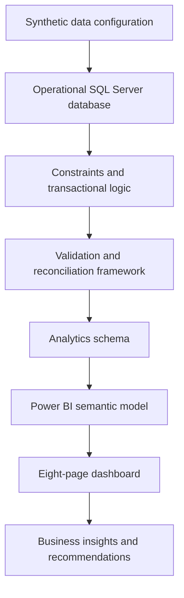
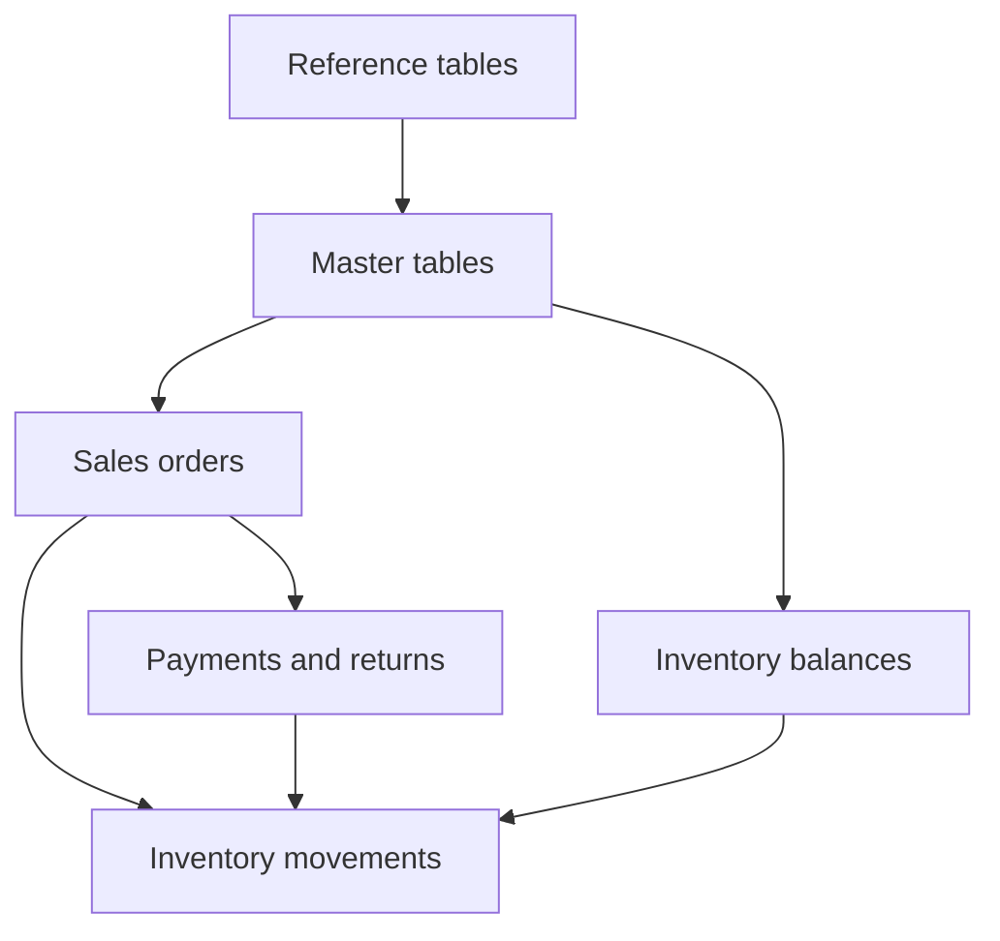
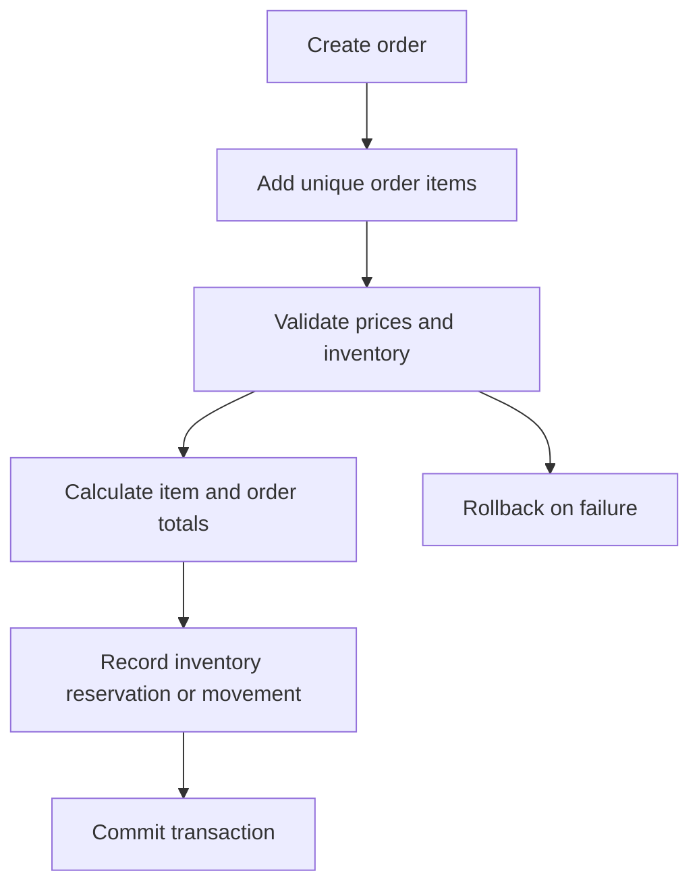
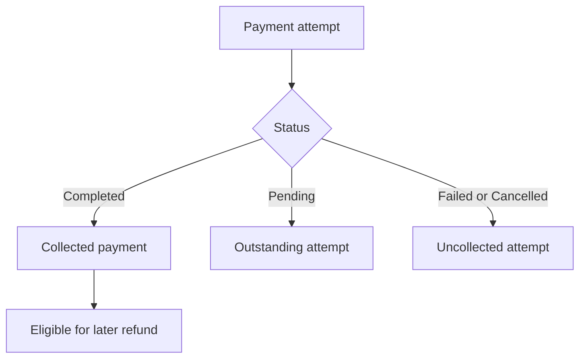
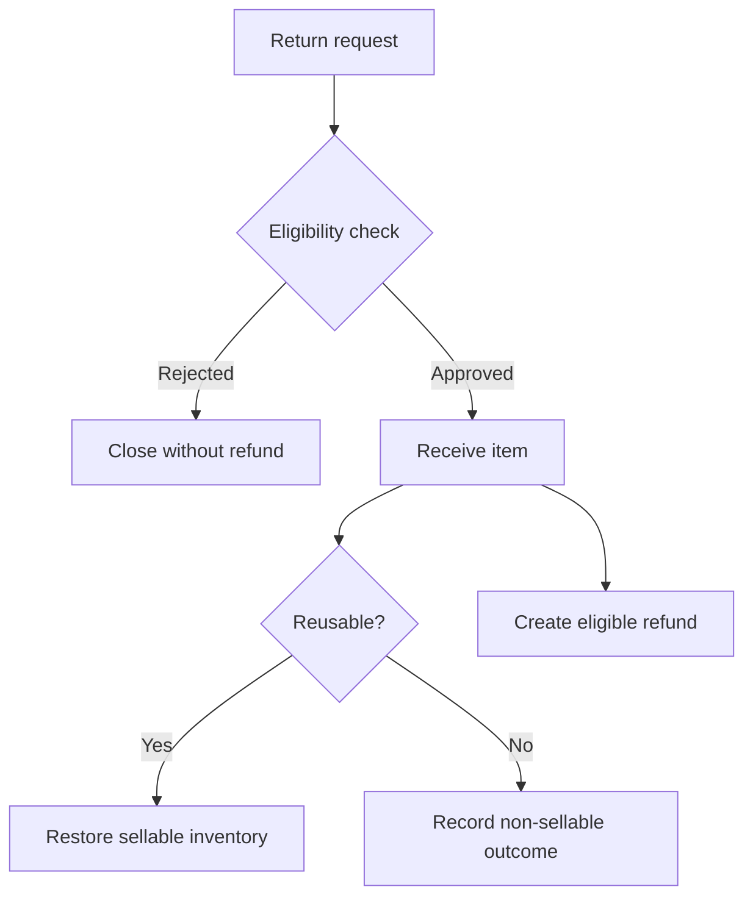
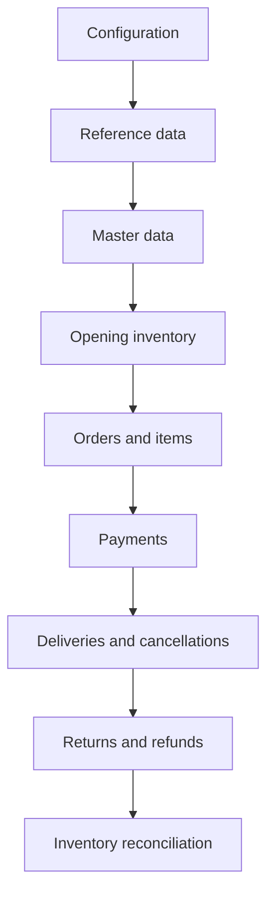
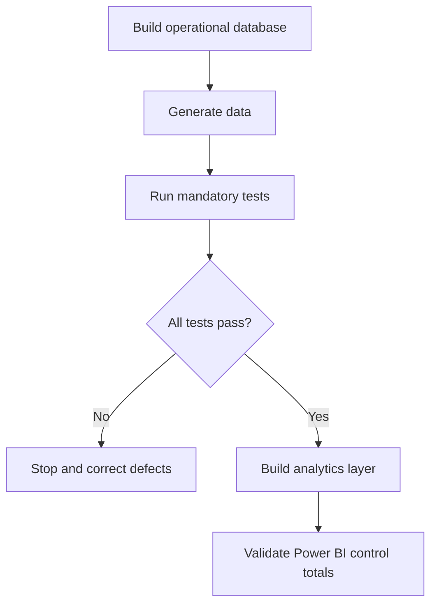
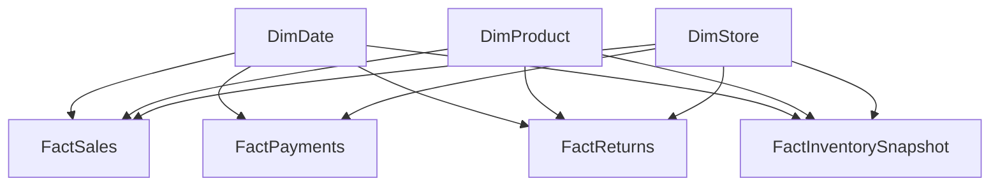

# Retail Sales & Inventory Intelligence Platform

## Project Architecture Document

| Document attribute | Value |
|---|---|
| Project name | Retail Sales & Inventory Intelligence Platform |
| Project version | 2.0 |
| Document | 03_Project_Architecture.md |
| Author | Akshay Aswani |
| Database platform | Microsoft SQL Server |
| Reporting platform | Microsoft Power BI |
| Status | Approved architecture baseline |
| Related documents | 01_Business_Requirements.md, 02_Business_Rules.md |

---

## 1. Purpose

This document defines the technical and analytical architecture for Version 2 of the Retail Sales & Inventory Intelligence Platform. It establishes how operational data will be created, validated, transformed and consumed by Power BI.

The architecture is designed to achieve five goals:

1. Preserve transactional integrity in SQL Server.
2. Separate operational processing from analytical reporting.
3. Prevent duplicated totals and ambiguous joins.
4. Make deployments and synthetic data reproducible.
5. Produce a professional multi-page Power BI portfolio solution.

## 2. Architectural principles

| Principle | Application |
|---|---|
| Correctness before complexity | Financial and inventory totals must reconcile before advanced analytics are added. |
| Separation of concerns | Operational tables, validation objects, analytical datasets and presentation logic remain separate. |
| One declared grain | Every table, view and fact dataset has a documented row-level meaning. |
| Single source of truth | KPI definitions are consistent across SQL, Power BI and documentation. |
| Set-based processing | Multi-row SQL operations are preferred over cursors and row-by-row logic. |
| Reproducibility | Fixed dates, controlled parameters and ordered scripts produce repeatable results. |
| Testability | Critical rules have automated assertions and reconciliation queries. |
| Portfolio transparency | README status and project claims reflect only implemented and validated work. |

## 3. High-level architecture



The system is a local portfolio implementation. SQL Server stores operational and analytical structures, while Power BI Desktop imports governed reporting datasets and applies reusable DAX measures.

## 4. Logical layers

| Layer | Responsibility | Primary technology |
|---|---|---|
| Configuration | Fixed dates, volumes, business distributions and generation parameters | T-SQL configuration tables/scripts |
| Operational data | Retail master data and transactional processes | SQL Server normalized tables |
| Database programming | Controlled writes, status changes and inventory movements | Stored procedures and limited set-based triggers |
| Data quality | Structural, lifecycle, financial and inventory validation | T-SQL assertions and reconciliation |
| Analytics | Dimensional facts, dimensions and reporting views | SQL Server analytics schema |
| Semantic model | Relationships, date intelligence and business measures | Power BI, Power Query and DAX |
| Presentation | Interactive pages, drill-through, tooltips and narrative | Power BI report |
| Documentation | Requirements, rules, design, execution and case study | Markdown, diagrams and screenshots |

## 5. SQL Server architecture

### 5.1 Database

Recommended database name:

```text
RetailIntelligenceDB
```

The database will use schemas to separate responsibilities.

| Schema | Purpose |
|---|---|
| `ref` | Reference and status lookup tables |
| `core` | Store, employee, customer, supplier and product master data |
| `sales` | Orders, order items, payments, returns and refunds |
| `inventory` | Inventory balances and movement ledger |
| `analytics` | Power BI-ready dimensions, facts and reporting views |
| `audit` | Deployment, validation and operational audit records where required |

Using schemas improves navigation, ownership clarity and object naming. Table names do not need redundant prefixes such as `tbl_`.

### 5.2 Operational model

The operational layer will follow a normalized relational design.



#### Reference domain

- Category
- SubCategory
- Brand
- OrderStatus
- PaymentMethod
- PaymentStatus
- ReturnReason
- ReturnStatus
- InventoryMovementType

#### Master domain

- Store
- Employee
- Customer
- Supplier
- Product

#### Sales domain

- SalesOrder
- SalesOrderItem
- OrderStatusHistory, if approved in detailed design
- Payment
- ProductReturn
- ProductReturnItem
- Refund or payment-event structure, subject to design confirmation

#### Inventory domain

- InventoryBalance
- InventoryMovement

The final table list, columns and relationships will be approved in `04_Database_Design.md`.

### 5.3 Object naming direction

Reserved words will not be used as table names. The V1 `[Order]` table will become `sales.SalesOrder`.

Examples:

```text
ref.OrderStatus
core.Product
sales.SalesOrder
sales.SalesOrderItem
inventory.InventoryBalance
analytics.FactSales
```

Detailed naming rules will be maintained in `06_Naming_Conventions.md`.

## 6. Transaction-processing architecture

Critical multi-table operations will be executed through stored procedures and SQL transactions.

### 6.1 Order processing



Planned procedure responsibilities:

- Validate customer, store and employee eligibility.
- Ensure the employee belongs to the selected store.
- Prevent duplicate products within the order.
- Validate inventory using grouped quantities.
- Copy transaction cost and selling prices to order items.
- Calculate monetary totals consistently.
- Create inventory movements atomically.
- Roll back the complete transaction when a critical rule fails.

### 6.2 Payment processing

Payment attempts will be retained as separate events so failed and repeated attempts remain measurable without inflating collected revenue.



### 6.3 Return processing



The return header and return-item separation allows a customer to return multiple products in one request while preserving item-level quantity, reason and refund eligibility.

## 7. Inventory architecture

Inventory requires both a current balance and an auditable movement history.

| Component | Purpose |
|---|---|
| InventoryBalance | Current on-hand and reserved quantity by product and store |
| InventoryMovement | Immutable record of every stock-changing event |

The movement ledger is the audit source. The balance table is the optimized current-state structure.

Baseline reconciliation:

```text
Expected Closing Stock
= Opening Stock
+ Purchase Receipts
+ Valid Customer Returns
+ Transfer In
+ Adjustments In
− Sales
− Damage Write-offs
− Transfer Out
− Adjustments Out
```

The calculated closing value must equal the current balance for every product-store combination.

## 8. Synthetic-data architecture

Synthetic data will be generated as a connected business process rather than as independent random tables.

### 8.1 Generation sequence



### 8.2 Reproducibility controls

- Fixed reporting period: 1 July 2023 through 30 June 2026
- Central configuration values for record counts
- Documented status and business distributions
- Stable business identifiers
- Dynamic key lookup rather than hard-coded identity assumptions
- Safe reset process in dependency order
- Post-generation validation before analytics objects are approved

### 8.3 Target scale

| Entity | Target |
|---|---:|
| Stores | 20 |
| Employees | 100 |
| Customers | 10,000 |
| Suppliers | 50 |
| Products | 500 |
| Orders | 100,000 |
| Order items | 250,000–400,000 |
| Payment attempts | 100,000–120,000 |
| Returns | 8,000–15,000 |

## 9. Data-quality architecture

Validation is a deployment gate, not a reporting afterthought.

### 9.1 Validation layers

| Validation layer | Examples |
|---|---|
| Schema | Expected tables, columns, keys and data types |
| Constraint | Enabled and trusted foreign, unique, check and default constraints |
| Master data | Unique business keys, valid hierarchies and active-state consistency |
| Transaction | Valid dates, statuses, quantities and relationships |
| Financial | Order totals, completed payments, refunds, revenue and profit |
| Inventory | Non-negative balances and movement reconciliation |
| Analytics | Fact grain, dimension uniqueness and absence of join fan-out |
| Power BI | SQL control totals equal DAX measure totals |

### 9.2 Validation behaviour

Each mandatory test will:

1. Calculate the exception count.
2. Store or display diagnostic rows.
3. Compare the result with the allowed threshold.
4. Use `THROW` when a critical threshold is exceeded.
5. Report PASS only when the assertion actually succeeds.

### 9.3 Deployment gate



## 10. Analytics architecture

The analytics layer will use a dimensional design optimized for Power BI.

### 10.1 Proposed dimensions

| Dimension | Purpose |
|---|---|
| DimDate | Calendar and financial-period analysis |
| DimCustomer | Customer attributes and segmentation |
| DimProduct | Product, brand, subcategory and category hierarchy |
| DimStore | Store and geography analysis |
| DimEmployee | Employee and manager analysis |
| DimSupplier | Supplier analysis |
| DimPaymentMethod | Payment-channel analysis |
| DimOrderStatus | Order lifecycle reporting |
| DimPaymentStatus | Payment-attempt reporting |
| DimReturnReason | Return-cause analysis |

Flattening stable hierarchies such as product-to-category into dimensions is acceptable in the analytical layer even though the operational source remains normalized.

### 10.2 Proposed facts and grains

| Fact | Grain | Primary purpose |
|---|---|---|
| FactSales | One row per sales-order item | Revenue, units, COGS, profit and product analysis |
| FactPayments | One row per payment attempt/event | Payment success, collections and channel analysis |
| FactReturns | One row per returned order item | Return quantity, reason, refund and quality analysis |
| FactInventorySnapshot | One row per product-store snapshot date | Stock level, value and availability trends |
| FactInventoryMovement | One row per inventory movement | Inventory inflow, outflow and reconciliation |

### 10.3 Conformed dimensions

Shared dimensions will filter multiple facts consistently.



Power BI will not create direct fact-to-fact relationships. Cross-fact analysis will use shared dimensions and explicit measures.

## 11. Historical-data strategy

For the baseline portfolio release:

- Transaction facts preserve historical unit cost and selling price.
- Master dimensions initially use current descriptive attributes.
- Important historical events remain in operational transaction and movement tables.
- Slowly changing dimension Type 2 is not required for the first release unless store, employee or product history materially affects analysis.

If Type 2 history is added later, surrogate dimension keys, effective dates and current-row indicators will be documented before implementation.

## 12. Power BI architecture

### 12.1 Connection mode

Power BI Desktop will use **Import mode** for the baseline project because the planned dataset fits comfortably within a portfolio-scale semantic model and requires fast interaction.

### 12.2 Model standards

- One-to-many relationships from dimensions to facts
- Single-direction filtering by default
- Shared marked date dimension
- Dedicated measures table
- Technical keys hidden from report view
- Explicit measures for business KPIs
- Display folders and measure descriptions
- SQL-to-DAX control-total checks
- No bidirectional relationship without documented justification
- No direct relationship between fact tables

### 12.3 Power Query responsibilities

Power Query will be limited to:

- Selecting required SQL objects and columns
- Applying documented data types
- Renaming fields for report usability
- Adding only lightweight presentation attributes
- Disabling load for staging queries when required

Core business logic, financial reconciliation and dimensional construction should remain in SQL wherever practical.

### 12.4 Measure organization

Planned display folders:

```text
00 Control Totals
01 Revenue
02 Orders
03 Customers
04 Products
05 Inventory
06 Payments
07 Returns
08 Stores and Employees
09 Suppliers
10 Time Intelligence
11 Dynamic Titles and UX
```

## 13. Dashboard architecture

| Page | Main audience | Core analytical focus |
|---|---|---|
| 01 Executive Summary | Leadership | Revenue, profit, growth, orders and risks |
| 02 Sales Performance | Sales management | Trends, stores, regions and average order value |
| 03 Customer Insights | Marketing/customer team | RFM, cohorts, retention and lifetime value |
| 04 Product Performance | Category/product team | Revenue, margin, units, ABC/XYZ and affinity |
| 05 Inventory Management | Operations | Stock health, value, stockouts and replenishment |
| 06 Store & Employee Performance | Operations leadership | Store comparison and employee productivity |
| 07 Returns & Payments | Finance/quality | Collections, failures, refunds and return causes |
| 08 Supplier Analysis | Procurement leadership | Contribution, dependency and quality risk |

### 13.1 Navigation and interaction

- Consistent left or top navigation across all pages
- Synced date and major business slicers
- Reset-filter button on every analytical page
- Dynamic selected-period and filter-context labels
- Drill-through only where it supports a clear decision
- Tooltip pages for supplemental detail
- Controlled visual interactions
- Accessible contrast and consistent number formats

## 14. Security and privacy architecture

The project uses synthetic data only. No credentials or real personal information will be committed.

Repository exclusions shall include:

- SQL Server database and log files
- Database backups
- Credentials and local connection settings
- Temporary Power BI files
- Generated caches and local editor files

Role-based database access and Power BI row-level security may be demonstrated later, but they are not required for the baseline release.

## 15. Performance architecture

### 15.1 SQL Server

- Use suitable data types and narrow keys.
- Index foreign keys and common filter paths only when justified.
- Prefer covering indexes for high-value dashboard queries when measured.
- Avoid redundant indexes already covered by unique constraints.
- Use set-based transformations.
- Capture execution plans and logical reads for selected optimization examples.
- Do not run maintenance operations as part of normal analytical query execution.

### 15.2 Power BI

- Import only required columns and rows.
- Use a star schema and avoid unnecessary calculated columns.
- Prefer numeric surrogate keys for relationships.
- Use explicit measures and reusable base measures.
- Limit high-cardinality text fields in visuals.
- Validate page and visual performance before release.

## 16. Deployment architecture

### 16.1 Script phases

| Phase | Folder | Output |
|---|---|---|
| 1 | `01_Database_Setup` | Database, schemas, tables, constraints and indexes |
| 2 | `02_Data_Generation` | Reference, master and connected transaction data |
| 3 | `03_Database_Objects` | Procedures, functions, views and controlled triggers |
| 4 | `04_Data_Validation` | Assertions and reconciliation tests |
| 5 | `05_Analytics_Model` | Dimensions, facts and reporting views |
| 6 | `06_Business_Analysis` | Selected decision-focused analytical queries |
| 7 | `07_PowerBI` | Semantic model, report, theme and screenshots |
| 8 | `08_Documentation` | Technical and business documentation |
| 9 | `09_Case_Study` | Insights, recommendations and limitations |
| 10 | `10_Execution_Order` | Master runner, validation runner and reset script |

### 16.2 Master execution flow

```text
Run_Full_Project.sql
  1. Create database and schemas
  2. Create tables
  3. Create constraints
  4. Load reference data
  5. Load master data
  6. Generate connected transactions
  7. Create indexes and database objects
  8. Run operational validation
  9. Build analytics layer
 10. Run analytics validation
```

Maintenance demonstrations and large analytical result sets will not be part of automatic deployment.

## 17. Repository architecture

```text
Retail-Sales-Inventory-Intelligence-V2/
├── README.md
├── LICENSE
├── .gitignore
├── 01_Database_Setup/
├── 02_Data_Generation/
├── 03_Database_Objects/
├── 04_Data_Validation/
├── 05_Analytics_Model/
├── 06_Business_Analysis/
├── 07_PowerBI/
│   ├── Report/
│   ├── Screenshots/
│   └── Theme/
├── 08_Documentation/
├── 09_Case_Study/
└── 10_Execution_Order/
```

File numbering restarts within each folder. Download suffixes such as `(1)` and `(2)` will not be used in repository filenames.

## 18. Environment assumptions

| Component | Baseline assumption |
|---|---|
| Operating system | Windows 10/11 |
| Database | Supported Microsoft SQL Server edition |
| SQL client | SQL Server Management Studio |
| Reporting | Current supported Power BI Desktop release |
| Version control | Git and GitHub |
| Power BI mode | Import |
| Currency | Indian rupees |
| Date range | 1 July 2023–30 June 2026 |
| Data classification | Synthetic/public portfolio data |

Exact version requirements will be recorded in the execution guide after implementation testing.

## 19. Architecture decision records

The following major decisions are approved:

| Decision ID | Decision | Reason |
|---|---|---|
| ADR-001 | Rebuild V2 rather than patch V1 | Correct business logic and remove inherited structural problems |
| ADR-002 | Separate operational and analytical layers | Protect transactional integrity and simplify Power BI |
| ADR-003 | Use SQL schemas by responsibility | Improve organization and reduce naming ambiguity |
| ADR-004 | Replace `[Order]` with `sales.SalesOrder` | Avoid reserved-word handling and improve clarity |
| ADR-005 | Use an inventory movement ledger plus balance table | Provide auditability and efficient current-state reporting |
| ADR-006 | Separate return header and return items | Support multi-item returns and item-level refund logic |
| ADR-007 | Retain individual payment attempts | Measure failures without overstating collected revenue |
| ADR-008 | Use assertion-based validation | Prevent false PASS messages and make quality measurable |
| ADR-009 | Use a dimensional analytics model | Create reliable fact grains and Power BI relationships |
| ADR-010 | Use Power BI Import mode | Appropriate performance for portfolio-scale data |

## 20. Open design decisions

The detailed database-design phase must finalize:

1. Inventory reservation implementation.
2. Dedicated order-status history table.
3. Dedicated Refund table versus payment-event representation.
4. Employee store-assignment history.
5. Product price-history requirements.
6. Inventory snapshot frequency.
7. Tax-rate structures and category exceptions.
8. Whether analytics objects are views, persisted tables or a combination.

These decisions must be resolved before the corresponding tables and generation scripts are finalized.

## 21. Architecture acceptance criteria

The architecture is considered successfully implemented when:

- Operational and analytical objects are separated by schema and responsibility.
- Every operational and fact table has a documented grain.
- Critical multi-table processes execute transactionally.
- Inventory balances reconcile with movements.
- Orders reconcile with items, payments and refunds.
- Mandatory validation failures stop deployment.
- Power BI uses conformed dimensions and no direct fact-to-fact relationships.
- SQL and DAX control totals agree.
- The eight dashboard pages operate on validated measures.
- Repository documentation matches the delivered architecture.

## 22. Next deliverable

The next document is:

```text
04_Database_Design.md
```

It will finalize the operational tables, columns, primary keys, foreign keys, cardinalities, table grains and the first version of the ER model.

