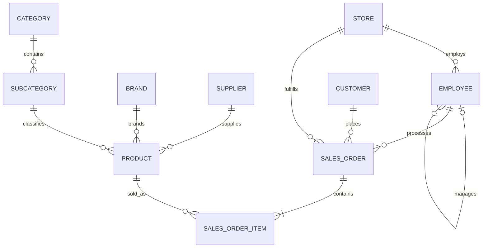
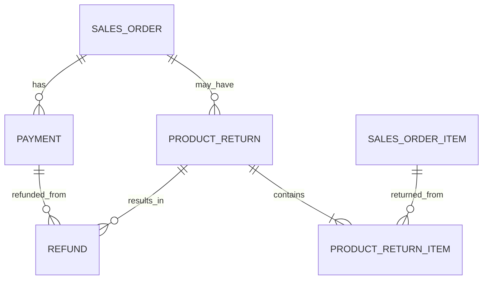
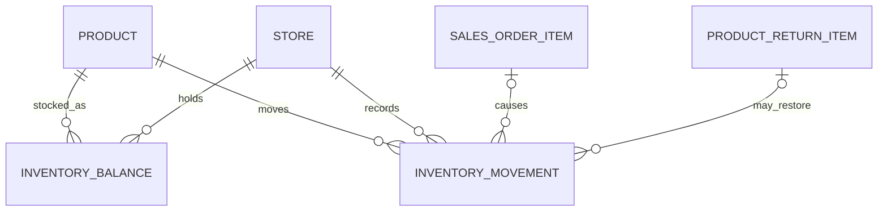

# Retail Sales & Inventory Intelligence Platform

## Database Design Document

| Document attribute | Value |
|---|---|
| Project name | Retail Sales & Inventory Intelligence Platform |
| Project version | 2.0 |
| Document | 04_Database_Design.md |
| Author | Akshay Aswani |
| Database | RetailIntelligenceDB |
| Platform | Microsoft SQL Server |
| Status | Approved operational-model baseline |
| Related documents | 01_Business_Requirements.md, 02_Business_Rules.md, 03_Project_Architecture.md |

---

## 1. Purpose

This document defines the Version 2 operational database model before SQL implementation begins. It specifies:

- Database schemas
- Table inventory and grain
- Major columns and data types
- Primary, foreign and alternate keys
- Relationship cardinalities
- Lifecycle and financial structures
- Inventory balance and movement design
- Deletion, audit and indexing principles
- Decisions carried into the ER diagram and SQL scripts

Column-level descriptions will be expanded in `05_Data_Dictionary.md`. This document is the authoritative structural baseline for `03_Create_Tables.sql` and `04_Create_Constraints.sql`.

## 2. Database and schema design

Recommended database:

```text
RetailIntelligenceDB
```

| Schema | Responsibility |
|---|---|
| `ref` | Controlled classifications, statuses and movement types |
| `core` | Stores, employees, customers, suppliers and products |
| `sales` | Orders, status history, payments, returns and refunds |
| `inventory` | Current inventory balances and immutable movements |
| `audit` | Validation-run metadata and validation results |
| `analytics` | Dimensions, facts and Power BI-ready objects created later |

## 3. Approved design decisions

| Decision | Approved approach |
|---|---|
| Order table name | Use `sales.SalesOrder`; do not use reserved word `[Order]` |
| Order status history | Implement `sales.OrderStatusHistory` |
| Refund representation | Implement dedicated `sales.Refund` linked to Payment and ProductReturn |
| Employee assignment history | Keep one current primary store in baseline release |
| Product price history | Preserve transaction cost/price on SalesOrderItem; no separate history table initially |
| Inventory balance | Persist current balance and reconcile to immutable movement ledger |
| Inventory reservation | Store `QuantityOnHand` and `QuantityReserved`; derive available quantity |
| Inventory snapshots | Create daily/periodic snapshot fact in analytics layer, not operational layer |
| Returns | Separate ProductReturn header and ProductReturnItem detail |
| Tax | Store TaxRate and TaxAmount at order-item level |
| Deletion | Use IsActive or lifecycle status; avoid hard deletes of referenced business records |
| Analytical model | Build separately under `analytics` after operational validation |

## 4. Table inventory

The operational and audit model contains **25 tables**.

| Schema | Table | Grain | Category |
|---|---|---|---|
| ref | Category | One row per product category | Reference |
| ref | SubCategory | One row per subcategory within a category | Reference |
| ref | Brand | One row per product brand | Reference |
| ref | OrderStatus | One row per allowed order status | Reference |
| ref | PaymentMethod | One row per payment method | Reference |
| ref | PaymentStatus | One row per payment status | Reference |
| ref | ReturnReason | One row per return reason | Reference |
| ref | ReturnStatus | One row per return status | Reference |
| ref | InventoryMovementType | One row per inventory movement classification | Reference |
| core | Store | One row per physical store | Master |
| core | Employee | One row per employee | Master |
| core | Customer | One row per customer | Master |
| core | Supplier | One row per supplier | Master |
| core | Product | One row per sellable product | Master |
| sales | SalesOrder | One row per customer order | Transaction header |
| sales | SalesOrderItem | One row per unique product in an order | Transaction detail |
| sales | OrderStatusHistory | One row per order-status transition | Event history |
| sales | Payment | One row per payment attempt/event | Financial event |
| sales | ProductReturn | One row per return request | Transaction header |
| sales | ProductReturnItem | One row per order item within a return request | Transaction detail |
| sales | Refund | One row per refund event | Financial event |
| inventory | InventoryBalance | One row per product-store combination | Current balance |
| inventory | InventoryMovement | One row per stock-changing event | Movement ledger |
| audit | ValidationRun | One row per validation execution | Audit header |
| audit | ValidationResult | One row per validation test within a run | Audit detail |

## 5. Reference tables

### 5.1 `ref.Category`

**Grain:** one product category.

| Column | Type | Null | Key/default | Purpose |
|---|---|---:|---|---|
| CategoryID | INT | No | PK, identity | Surrogate key |
| CategoryCode | VARCHAR(20) | No | UQ | Stable business code |
| CategoryName | VARCHAR(100) | No | UQ | Display name |
| Description | VARCHAR(255) | Yes |  | Business description |
| IsActive | BIT | No | Default 1 | Active-state flag |
| CreatedDate | DATETIME2(0) | No | Default system timestamp | Audit timestamp |
| ModifiedDate | DATETIME2(0) | Yes |  | Last material change |

### 5.2 `ref.SubCategory`

**Grain:** one subcategory within one category.

| Column | Type | Null | Key/default |
|---|---|---:|---|
| SubCategoryID | INT | No | PK, identity |
| CategoryID | INT | No | FK → ref.Category |
| SubCategoryCode | VARCHAR(20) | No | UQ |
| SubCategoryName | VARCHAR(100) | No | UQ with CategoryID |
| Description | VARCHAR(255) | Yes |  |
| IsActive | BIT | No | Default 1 |
| CreatedDate | DATETIME2(0) | No | Default system timestamp |
| ModifiedDate | DATETIME2(0) | Yes |  |

### 5.3 `ref.Brand`

**Grain:** one product brand.

| Column | Type | Null | Key/default |
|---|---|---:|---|
| BrandID | INT | No | PK, identity |
| BrandCode | VARCHAR(20) | No | UQ |
| BrandName | VARCHAR(100) | No | UQ |
| Description | VARCHAR(255) | Yes |  |
| IsActive | BIT | No | Default 1 |
| CreatedDate | DATETIME2(0) | No | Default system timestamp |
| ModifiedDate | DATETIME2(0) | Yes |  |

### 5.4 Status and method tables

The following tables share a compact controlled-list design:

- `ref.OrderStatus`
- `ref.PaymentMethod`
- `ref.PaymentStatus`
- `ref.ReturnReason`
- `ref.ReturnStatus`
- `ref.InventoryMovementType`

Recommended shared columns:

| Column pattern | Type | Purpose |
|---|---|---|
| `<Entity>ID` | SMALLINT | Primary surrogate key |
| `<Entity>Code` | VARCHAR(30) | Stable unique business code |
| `<Entity>Name` | VARCHAR(100) | User-facing label |
| Description | VARCHAR(255) | Definition |
| SortOrder | TINYINT | Stable display sequence |
| IsActive | BIT | Controls future use |
| CreatedDate | DATETIME2(0) | Audit timestamp |

`ref.InventoryMovementType` additionally contains:

| Column | Type | Purpose |
|---|---|---|
| QuantityDirection | SMALLINT | `1` for stock increase, `-1` for decrease |
| RequiresReference | BIT | Indicates whether a source transaction should be supplied |

## 6. Master tables

### 6.1 `core.Store`

**Grain:** one physical retail store.

| Column | Type | Null | Key/default |
|---|---|---:|---|
| StoreID | INT | No | PK, identity |
| StoreCode | VARCHAR(20) | No | UQ |
| StoreName | VARCHAR(100) | No | UQ |
| ManagerEmployeeID | INT | Yes | FK → core.Employee, added after Employee creation |
| AddressLine | VARCHAR(255) | No |  |
| City | VARCHAR(100) | No |  |
| State | VARCHAR(100) | No |  |
| PostalCode | VARCHAR(10) | Yes |  |
| Country | VARCHAR(100) | No | Default India |
| Phone | VARCHAR(20) | Yes |  |
| OpeningDate | DATE | No |  |
| ClosingDate | DATE | Yes |  |
| IsActive | BIT | No | Default 1 |
| CreatedDate | DATETIME2(0) | No | Default system timestamp |
| ModifiedDate | DATETIME2(0) | Yes |  |

The circular Store–Employee manager relationship is resolved by creating both tables first and adding `FK_Store_ManagerEmployee` afterward.

### 6.2 `core.Employee`

**Grain:** one employee.

| Column | Type | Null | Key/default |
|---|---|---:|---|
| EmployeeID | INT | No | PK, identity |
| EmployeeCode | VARCHAR(20) | No | UQ |
| StoreID | INT | No | FK → core.Store |
| ManagerEmployeeID | INT | Yes | Self-referencing FK |
| FirstName | VARCHAR(50) | No |  |
| LastName | VARCHAR(50) | No |  |
| Email | VARCHAR(150) | Yes | Filtered UQ |
| Phone | VARCHAR(20) | Yes |  |
| JobTitle | VARCHAR(100) | No |  |
| Salary | DECIMAL(12,2) | No | Check > 0 |
| HireDate | DATE | No |  |
| TerminationDate | DATE | Yes | Check >= HireDate |
| IsActive | BIT | No | Default 1 |
| CreatedDate | DATETIME2(0) | No | Default system timestamp |
| ModifiedDate | DATETIME2(0) | Yes |  |

### 6.3 `core.Customer`

**Grain:** one customer.

| Column | Type | Null | Key/default |
|---|---|---:|---|
| CustomerID | INT | No | PK, identity |
| CustomerCode | VARCHAR(20) | No | UQ |
| FirstName | VARCHAR(50) | No |  |
| LastName | VARCHAR(50) | No |  |
| Email | VARCHAR(150) | Yes | Filtered UQ |
| Phone | VARCHAR(20) | Yes |  |
| AddressLine | VARCHAR(255) | Yes |  |
| City | VARCHAR(100) | Yes |  |
| State | VARCHAR(100) | Yes |  |
| PostalCode | VARCHAR(10) | Yes |  |
| Country | VARCHAR(100) | Yes |  |
| RegistrationDate | DATE | No |  |
| LoyaltyPoints | INT | No | Default 0, check >= 0 |
| IsActive | BIT | No | Default 1 |
| CreatedDate | DATETIME2(0) | No | Default system timestamp |
| ModifiedDate | DATETIME2(0) | Yes |  |

### 6.4 `core.Supplier`

**Grain:** one supplier.

| Column | Type | Null | Key/default |
|---|---|---:|---|
| SupplierID | INT | No | PK, identity |
| SupplierCode | VARCHAR(20) | No | UQ |
| SupplierName | VARCHAR(150) | No | UQ |
| ContactName | VARCHAR(100) | Yes |  |
| Email | VARCHAR(150) | Yes | Filtered UQ |
| Phone | VARCHAR(20) | Yes |  |
| AddressLine | VARCHAR(255) | Yes |  |
| City | VARCHAR(100) | Yes |  |
| State | VARCHAR(100) | Yes |  |
| PostalCode | VARCHAR(10) | Yes |  |
| Country | VARCHAR(100) | Yes |  |
| IsActive | BIT | No | Default 1 |
| CreatedDate | DATETIME2(0) | No | Default system timestamp |
| ModifiedDate | DATETIME2(0) | Yes |  |

### 6.5 `core.Product`

**Grain:** one sellable product.

| Column | Type | Null | Key/default |
|---|---|---:|---|
| ProductID | INT | No | PK, identity |
| SKU | VARCHAR(40) | No | UQ |
| ProductName | VARCHAR(150) | No |  |
| SubCategoryID | INT | No | FK → ref.SubCategory |
| BrandID | INT | No | FK → ref.Brand |
| SupplierID | INT | No | FK → core.Supplier |
| CostPrice | DECIMAL(12,2) | No | Check > 0 |
| SellingPrice | DECIMAL(12,2) | No | Check > 0 |
| ReorderLevel | INT | No | Default 10, check >= 0 |
| ExcessStockLevel | INT | Yes | Check >= ReorderLevel |
| Barcode | VARCHAR(50) | Yes | Filtered UQ |
| Description | VARCHAR(500) | Yes |  |
| IsActive | BIT | No | Default 1 |
| CreatedDate | DATETIME2(0) | No | Default system timestamp |
| ModifiedDate | DATETIME2(0) | Yes |  |

## 7. Sales-order tables

### 7.1 `sales.SalesOrder`

**Grain:** one customer order placed at one store.

| Column | Type | Null | Key/default |
|---|---|---:|---|
| SalesOrderID | BIGINT | No | PK, identity |
| OrderNumber | VARCHAR(25) | No | UQ |
| CustomerID | INT | No | FK → core.Customer |
| StoreID | INT | No | FK → core.Store |
| EmployeeID | INT | No | FK → core.Employee |
| OrderStatusID | SMALLINT | No | FK → ref.OrderStatus |
| OrderDate | DATETIME2(0) | No |  |
| ConfirmedDate | DATETIME2(0) | Yes |  |
| ShippedDate | DATETIME2(0) | Yes |  |
| DeliveredDate | DATETIME2(0) | Yes |  |
| CancelledDate | DATETIME2(0) | Yes |  |
| SubtotalAmount | DECIMAL(14,2) | No | Default 0 |
| DiscountAmount | DECIMAL(14,2) | No | Default 0 |
| TaxAmount | DECIMAL(14,2) | No | Default 0 |
| NetAmount | DECIMAL(14,2) | No | Default 0 |
| Remarks | VARCHAR(500) | Yes |  |
| CreatedDate | DATETIME2(0) | No | Default system timestamp |
| ModifiedDate | DATETIME2(0) | Yes |  |

Header monetary fields are persisted for operational efficiency but must reconcile exactly with item totals within ₹0.01.

### 7.2 `sales.SalesOrderItem`

**Grain:** one unique product within one sales order.

| Column | Type | Null | Key/default |
|---|---|---:|---|
| SalesOrderItemID | BIGINT | No | PK, identity |
| SalesOrderID | BIGINT | No | FK → sales.SalesOrder |
| ProductID | INT | No | FK → core.Product |
| Quantity | INT | No | Check > 0 |
| UnitCost | DECIMAL(12,2) | No | Check > 0 |
| UnitPrice | DECIMAL(12,2) | No | Check > 0 |
| GrossAmount | DECIMAL(14,2) | No | Check >= 0 |
| DiscountAmount | DECIMAL(14,2) | No | Default 0 |
| TaxRate | DECIMAL(5,2) | No | Default 0 |
| TaxAmount | DECIMAL(14,2) | No | Default 0 |
| NetAmount | DECIMAL(14,2) | No | Check >= 0 |
| CreatedDate | DATETIME2(0) | No | Default system timestamp |
| ModifiedDate | DATETIME2(0) | Yes |  |

Alternate key:

```text
UNIQUE (SalesOrderID, ProductID)
```

### 7.3 `sales.OrderStatusHistory`

**Grain:** one recorded status transition for one order.

| Column | Type | Null | Key/default |
|---|---|---:|---|
| OrderStatusHistoryID | BIGINT | No | PK, identity |
| SalesOrderID | BIGINT | No | FK → sales.SalesOrder |
| FromOrderStatusID | SMALLINT | Yes | FK → ref.OrderStatus |
| ToOrderStatusID | SMALLINT | No | FK → ref.OrderStatus |
| StatusChangedDate | DATETIME2(0) | No |  |
| ChangedByEmployeeID | INT | Yes | FK → core.Employee |
| ChangeReason | VARCHAR(255) | Yes |  |
| CreatedDate | DATETIME2(0) | No | Default system timestamp |

The first history record may have a null `FromOrderStatusID`.

## 8. Payment and refund tables

### 8.1 `sales.Payment`

**Grain:** one payment attempt or payment event against an order.

| Column | Type | Null | Key/default |
|---|---|---:|---|
| PaymentID | BIGINT | No | PK, identity |
| SalesOrderID | BIGINT | No | FK → sales.SalesOrder |
| PaymentMethodID | SMALLINT | No | FK → ref.PaymentMethod |
| PaymentStatusID | SMALLINT | No | FK → ref.PaymentStatus |
| AttemptNumber | SMALLINT | No | Check > 0 |
| PaymentDate | DATETIME2(0) | No |  |
| Amount | DECIMAL(14,2) | No | Check > 0 |
| TransactionReference | VARCHAR(100) | Yes | Filtered UQ |
| FailureReason | VARCHAR(255) | Yes |  |
| Remarks | VARCHAR(255) | Yes |  |
| CreatedDate | DATETIME2(0) | No | Default system timestamp |
| ModifiedDate | DATETIME2(0) | Yes |  |

Recommended alternate key:

```text
UNIQUE (SalesOrderID, AttemptNumber)
```

Failed and cancelled attempts remain stored for payment-success analysis but are excluded from collected revenue.

### 8.2 `sales.Refund`

**Grain:** one refund event against one completed payment and return request.

| Column | Type | Null | Key/default |
|---|---|---:|---|
| RefundID | BIGINT | No | PK, identity |
| PaymentID | BIGINT | No | FK → sales.Payment |
| ProductReturnID | BIGINT | No | FK → sales.ProductReturn |
| RefundDate | DATETIME2(0) | No |  |
| RefundAmount | DECIMAL(14,2) | No | Check > 0 |
| RefundReference | VARCHAR(100) | Yes | Filtered UQ |
| RefundStatus | VARCHAR(20) | No | Controlled check: Pending/Completed/Failed |
| Remarks | VARCHAR(255) | Yes |  |
| CreatedDate | DATETIME2(0) | No | Default system timestamp |
| ModifiedDate | DATETIME2(0) | Yes |  |

A refund table is intentionally separate from Payment so that successful collections and cash outflows remain distinguishable.

## 9. Return tables

### 9.1 `sales.ProductReturn`

**Grain:** one return request for one original sales order.

| Column | Type | Null | Key/default |
|---|---|---:|---|
| ProductReturnID | BIGINT | No | PK, identity |
| ReturnNumber | VARCHAR(25) | No | UQ |
| SalesOrderID | BIGINT | No | FK → sales.SalesOrder |
| ReturnStatusID | SMALLINT | No | FK → ref.ReturnStatus |
| RequestDate | DATETIME2(0) | No |  |
| ApprovedDate | DATETIME2(0) | Yes |  |
| ReceivedDate | DATETIME2(0) | Yes |  |
| ClosedDate | DATETIME2(0) | Yes |  |
| Remarks | VARCHAR(500) | Yes |  |
| CreatedDate | DATETIME2(0) | No | Default system timestamp |
| ModifiedDate | DATETIME2(0) | Yes |  |

### 9.2 `sales.ProductReturnItem`

**Grain:** one original sales-order item within one return request.

| Column | Type | Null | Key/default |
|---|---|---:|---|
| ProductReturnItemID | BIGINT | No | PK, identity |
| ProductReturnID | BIGINT | No | FK → sales.ProductReturn |
| SalesOrderItemID | BIGINT | No | FK → sales.SalesOrderItem |
| ReturnReasonID | SMALLINT | No | FK → ref.ReturnReason |
| QuantityRequested | INT | No | Check > 0 |
| QuantityAccepted | INT | No | Default 0, check >= 0 |
| EligibleRefundAmount | DECIMAL(14,2) | No | Default 0 |
| IsReusable | BIT | Yes | Set after inspection |
| InspectionNotes | VARCHAR(500) | Yes |  |
| CreatedDate | DATETIME2(0) | No | Default system timestamp |
| ModifiedDate | DATETIME2(0) | Yes |  |

Alternate key:

```text
UNIQUE (ProductReturnID, SalesOrderItemID)
```

Cross-table validation ensures the order item belongs to the return header's original order and cumulative accepted quantity does not exceed delivered quantity.

## 10. Inventory tables

### 10.1 `inventory.InventoryBalance`

**Grain:** one current inventory balance per product and store.

| Column | Type | Null | Key/default |
|---|---|---:|---|
| InventoryBalanceID | BIGINT | No | PK, identity |
| ProductID | INT | No | FK → core.Product |
| StoreID | INT | No | FK → core.Store |
| QuantityOnHand | INT | No | Default 0, check >= 0 |
| QuantityReserved | INT | No | Default 0, check >= 0 and <= on hand |
| LastMovementDate | DATETIME2(0) | Yes |  |
| LastRestockedDate | DATETIME2(0) | Yes |  |
| CreatedDate | DATETIME2(0) | No | Default system timestamp |
| ModifiedDate | DATETIME2(0) | Yes |  |

Alternate key:

```text
UNIQUE (ProductID, StoreID)
```

Available quantity is derived:

```text
QuantityAvailable = QuantityOnHand − QuantityReserved
```

It may be exposed through a computed column or reporting view.

### 10.2 `inventory.InventoryMovement`

**Grain:** one immutable stock-changing event for one product and store.

| Column | Type | Null | Key/default |
|---|---|---:|---|
| InventoryMovementID | BIGINT | No | PK, identity |
| ProductID | INT | No | FK → core.Product |
| StoreID | INT | No | FK → core.Store |
| InventoryMovementTypeID | SMALLINT | No | FK → ref.InventoryMovementType |
| MovementDate | DATETIME2(0) | No |  |
| Quantity | INT | No | Check > 0 |
| QuantityDirection | SMALLINT | No | Check in (-1, 1) |
| SalesOrderItemID | BIGINT | Yes | FK → sales.SalesOrderItem |
| ProductReturnItemID | BIGINT | Yes | FK → sales.ProductReturnItem |
| ReferenceNumber | VARCHAR(50) | Yes |  |
| Reason | VARCHAR(255) | Yes |  |
| CreatedByEmployeeID | INT | Yes | FK → core.Employee |
| CreatedDate | DATETIME2(0) | No | Default system timestamp |

Signed movement quantity is calculated as:

```text
SignedQuantity = Quantity × QuantityDirection
```

Movement rows are append-only. Corrections use compensating movements rather than destructive updates.

## 11. Audit tables

### 11.1 `audit.ValidationRun`

**Grain:** one execution of the validation suite.

| Column | Type | Null | Key/default |
|---|---|---:|---|
| ValidationRunID | BIGINT | No | PK, identity |
| RunStartDate | DATETIME2(0) | No |  |
| RunEndDate | DATETIME2(0) | Yes |  |
| EnvironmentName | VARCHAR(30) | No | Default Local |
| OverallStatus | VARCHAR(10) | No | Running/Passed/Failed |
| TotalTests | INT | No | Default 0 |
| PassedTests | INT | No | Default 0 |
| FailedTests | INT | No | Default 0 |
| Remarks | VARCHAR(500) | Yes |  |

### 11.2 `audit.ValidationResult`

**Grain:** one test result within one validation run.

| Column | Type | Null | Key/default |
|---|---|---:|---|
| ValidationResultID | BIGINT | No | PK, identity |
| ValidationRunID | BIGINT | No | FK → audit.ValidationRun |
| TestCode | VARCHAR(50) | No |  |
| TestName | VARCHAR(200) | No |  |
| Severity | VARCHAR(10) | No | Info/Warning/Critical |
| ExpectedValue | VARCHAR(100) | Yes |  |
| ActualValue | VARCHAR(100) | Yes |  |
| ExceptionCount | BIGINT | No | Default 0 |
| TestStatus | VARCHAR(10) | No | Passed/Failed |
| ExecutedDate | DATETIME2(0) | No | Default system timestamp |
| DiagnosticMessage | VARCHAR(1000) | Yes |  |

Alternate key:

```text
UNIQUE (ValidationRunID, TestCode)
```

## 12. Relationship model

### 12.1 Core relationship overview



### 12.2 Payment and return relationships



### 12.3 Inventory relationships



## 13. Cardinality rules

| Parent | Child | Cardinality | Rule |
|---|---|---|---|
| Category | SubCategory | 1 to many | Every subcategory has one category |
| SubCategory | Product | 1 to many | Every product has one subcategory |
| Brand | Product | 1 to many | Every product has one brand |
| Supplier | Product | 1 to many | Every product has one supplier in baseline design |
| Store | Employee | 1 to many | Every employee has one primary store |
| Employee | Employee | 1 to many optional | Employee may have one manager |
| Customer | SalesOrder | 1 to many | Every order has one customer |
| Store | SalesOrder | 1 to many | Every order belongs to one store |
| Employee | SalesOrder | 1 to many | Every order is processed by one employee |
| SalesOrder | SalesOrderItem | 1 to one-or-many | Confirmed order requires at least one item |
| SalesOrder | Payment | 1 to zero-or-many | Multiple attempts allowed |
| SalesOrder | ProductReturn | 1 to zero-or-many | Multiple return requests allowed |
| ProductReturn | ProductReturnItem | 1 to one-or-many | Return request contains items |
| Payment | Refund | 1 to zero-or-many | Partial refunds allowed |
| ProductReturn | Refund | 1 to zero-or-many | Refund events may be staged |
| Product + Store | InventoryBalance | 1 to zero-or-one | One current balance per combination |
| Product + Store | InventoryMovement | 1 to many | Multiple movement events |

## 14. Key strategy

### 14.1 Surrogate primary keys

- Reference and master tables use `INT` or `SMALLINT` identity keys.
- High-volume transactions and events use `BIGINT` identity keys.
- Analytics dimensions and facts will have their own surrogate keys where appropriate.

### 14.2 Business alternate keys

| Entity | Alternate key |
|---|---|
| Category | CategoryCode and CategoryName |
| SubCategory | SubCategoryCode; CategoryID + SubCategoryName |
| Brand | BrandCode and BrandName |
| Store | StoreCode and StoreName |
| Employee | EmployeeCode; non-null Email |
| Customer | CustomerCode; non-null Email |
| Supplier | SupplierCode and SupplierName |
| Product | SKU; non-null Barcode |
| SalesOrder | OrderNumber |
| Payment | SalesOrderID + AttemptNumber; non-null TransactionReference |
| ProductReturn | ReturnNumber |
| Refund | non-null RefundReference |

## 15. Referential actions

Default foreign-key behaviour will be `NO ACTION`.

The project will not use broad cascading deletes because they could remove historical financial and inventory records. Controlled status changes or compensating transactions are preferred.

Cascade delete may be considered only for non-production staging objects, not for the operational portfolio model.

## 16. Check-constraint strategy

Database check constraints will enforce row-level rules including:

- Positive prices, payment amounts and movement quantities
- Non-negative discounts, taxes, loyalty points and inventory balances
- Accepted quantity not greater than requested quantity within a return row
- Date ordering within the same row
- Quantity direction limited to `-1` or `1`
- Refund status controlled to documented values
- Validation status and severity controlled to documented values

Cross-table rules such as employee-store consistency, cumulative refund limits and total returned quantity require procedures or validation tests.

## 17. Index baseline

Indexes will be added after keys and representative query patterns are established.

### 17.1 Automatically supported access paths

- Clustered primary-key indexes
- Unique indexes generated by alternate-key constraints

### 17.2 Candidate indexes

| Table | Candidate key columns | Possible includes/purpose |
|---|---|---|
| SalesOrder | OrderDate, OrderStatusID | CustomerID, StoreID, EmployeeID, NetAmount |
| SalesOrder | CustomerID, OrderDate | Order history |
| SalesOrder | StoreID, OrderDate | Store performance |
| SalesOrderItem | ProductID, SalesOrderID | Quantity, UnitCost, UnitPrice, NetAmount |
| Payment | SalesOrderID, PaymentStatusID | PaymentDate, Amount |
| Payment | PaymentDate, PaymentStatusID | Collection trends |
| ProductReturn | SalesOrderID, ReturnStatusID | RequestDate |
| ProductReturnItem | SalesOrderItemID | QuantityAccepted, EligibleRefundAmount |
| InventoryBalance | StoreID, ProductID | QuantityOnHand, QuantityReserved |
| InventoryMovement | ProductID, StoreID, MovementDate | Quantity, QuantityDirection |

Final indexes require execution-plan or workload justification. The unique `(ProductID, StoreID)` balance index already supports ProductID-leading lookups and should not be duplicated without evidence.

## 18. Audit-column policy

| Column | Rule |
|---|---|
| CreatedDate | Set once on insert using a default system timestamp |
| ModifiedDate | Updated only when persisted business fields change |
| IsActive | Used for reference and master records, not event transactions |

Event tables such as InventoryMovement and OrderStatusHistory are append-only and generally do not require ModifiedDate.

## 19. Data-retention and deletion policy

- Reference and master records are deactivated, not deleted, when historically referenced.
- Orders, items, payments, returns, refunds and movements are retained.
- Test resets delete data only through a controlled script in child-to-parent dependency order.
- Production-like corrections use status changes or compensating events.
- Audit validation history may be retained across runs or explicitly reset in local development.

## 20. Analytics handoff

The operational model is not connected directly to Power BI as a 25-table snowflake. After validation, SQL objects under `analytics` will reshape the data into facts and conformed dimensions.

| Operational source | Analytical destination |
|---|---|
| Category, SubCategory, Brand, Product | DimProduct |
| Customer | DimCustomer |
| Store | DimStore |
| Employee | DimEmployee |
| Supplier | DimSupplier |
| SalesOrder + SalesOrderItem | FactSales |
| Payment + PaymentMethod + PaymentStatus | FactPayments |
| ProductReturn + ProductReturnItem + Refund | FactReturns |
| InventoryBalance | Current inventory reporting view and snapshot process |
| InventoryMovement | FactInventoryMovement |

## 21. Validation requirements for the design

The completed SQL implementation must verify:

- Exactly 25 expected operational/audit tables exist.
- Every table has a primary key.
- All documented foreign keys exist and are trusted.
- Filtered unique indexes allow multiple null emails but no duplicate populated emails.
- No duplicate product exists within an order.
- No duplicate product-store inventory balance exists.
- Every order status change has a valid transition.
- Order header amounts reconcile with items.
- Completed payments do not exceed payable order value.
- Completed refunds do not exceed completed collections or eligible return value.
- Accepted returns do not exceed delivered quantity.
- Inventory balances reconcile to signed movements.
- No negative on-hand, reserved or available quantity exists.

## 22. Expected creation order

```text
1. Create database
2. Create schemas
3. Create reference tables
4. Create Store without manager FK
5. Create Employee and other master tables
6. Add Store manager FK
7. Create sales-order and status-history tables
8. Create payment and return tables
9. Create refund table
10. Create inventory tables
11. Create audit tables
12. Add remaining constraints and indexes
13. Load reference and master data
14. Generate connected transactions
15. Run validation suite
```

## 23. Design-quality assessment

This model addresses the primary weaknesses identified in V1:

| V1 weakness | V2 design response |
|---|---|
| Reserved `[Order]` table name | `sales.SalesOrder` |
| Store manager not constrained | Deferred but explicit Store-to-Employee FK |
| Return tied directly to one item | Return header plus item detail |
| Refund not independently modelled | Dedicated Refund event table |
| Payments treated as one successful amount | Multiple payment attempts retained |
| Inventory without audit trail | Balance plus immutable movement ledger |
| No status history | OrderStatusHistory table |
| Nullable unique email issue | Filtered unique indexes |
| Validation printed unconditional PASS | Validation-run and result structures plus assertions |
| Direct reporting risk | Separate analytics schema and fact grains |

## 24. Next deliverables

The next documents and artifacts are:

1. `05_Data_Dictionary.md`
2. `06_Naming_Conventions.md`
3. `07_ER_Diagram.md` and rendered ER image
4. SQL scripts beginning with `01_Create_Database.sql` and `02_Create_Schemas.sql`

The data dictionary will expand every approved column with definition, valid values, example and associated business rule.

