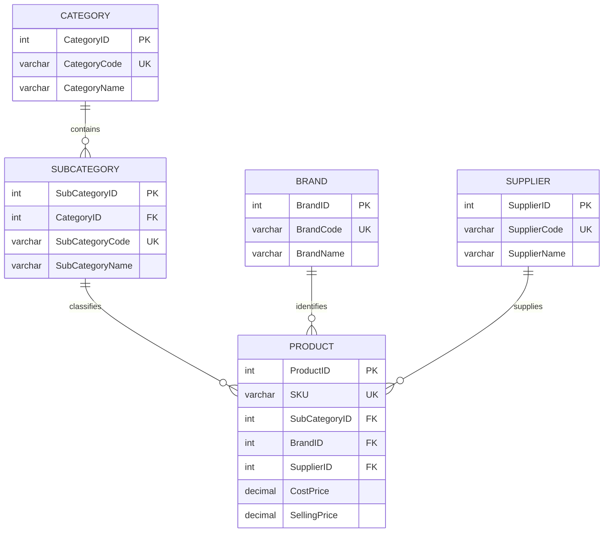
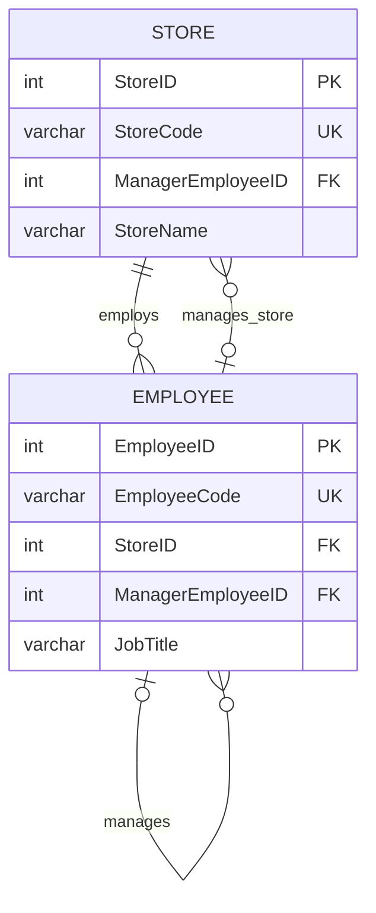
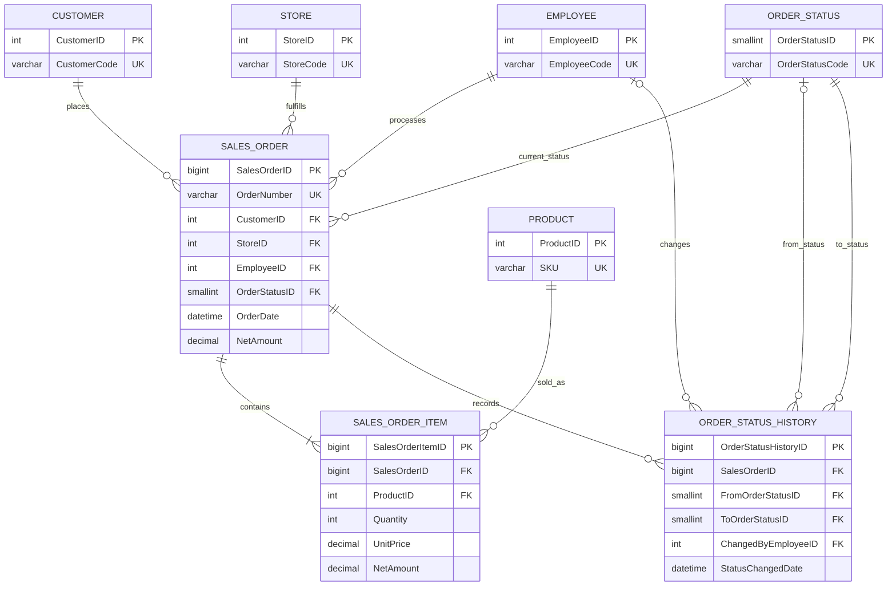
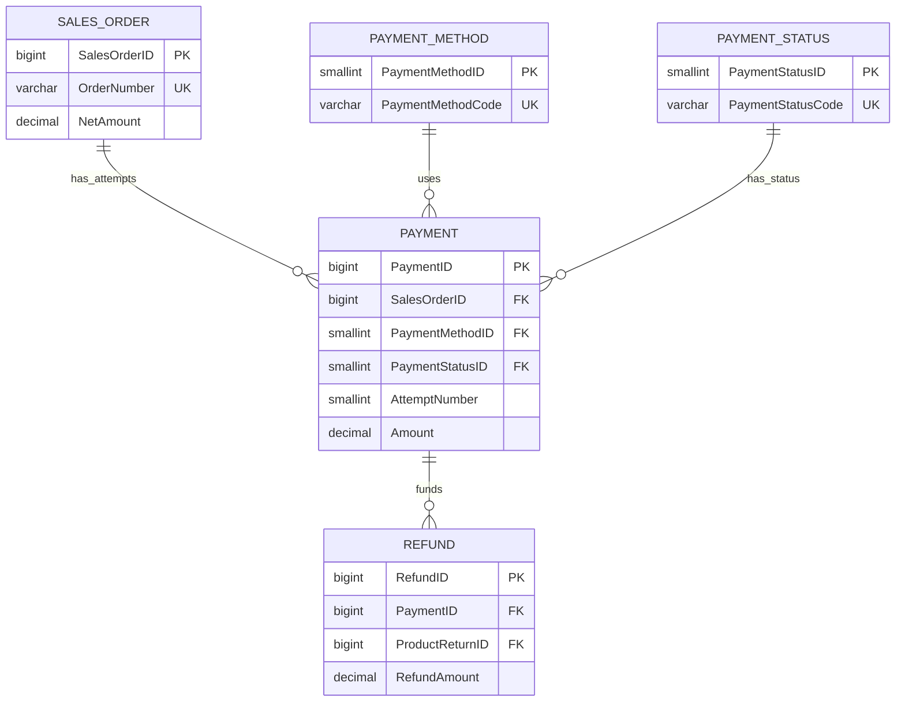
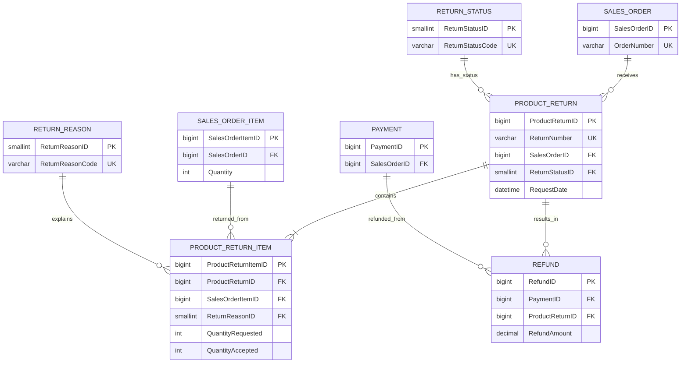
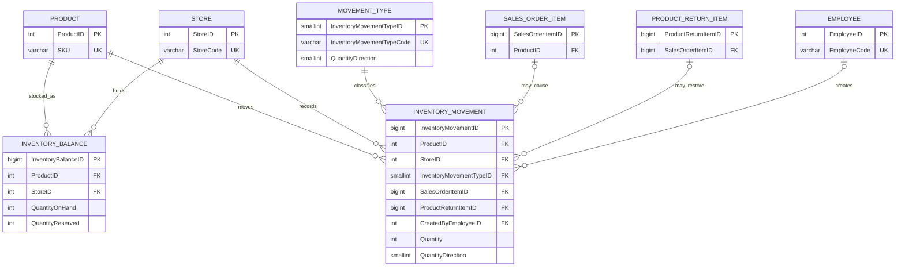

# Retail Sales & Inventory Intelligence Platform

## Entity Relationship Diagram and Relationship Specification

| Document attribute | Value |
|---|---|
| Project name | Retail Sales & Inventory Intelligence Platform |
| Project version | 2.0 |
| Document | 07_ER_Diagram.md |
| Author | Akshay Aswani |
| Database | RetailIntelligenceDB |
| Platform | Microsoft SQL Server |
| Status | Approved logical relationship baseline |
| Related documents | 04_Database_Design.md, 05_Data_Dictionary.md, 06_Naming_Conventions.md |

---

## 1. Purpose

This document presents the entity relationships for the Version 2 operational and validation model. It translates the approved database design into implementation-ready relationship maps, cardinality rules and foreign-key specifications.

The model contains **25 tables** across five schemas:

| Schema | Table count | Responsibility |
|---|---:|---|
| `ref` | 9 | Controlled classifications, statuses and movement types |
| `core` | 5 | Stores, employees, customers, suppliers and products |
| `sales` | 7 | Orders, items, status history, payments, returns and refunds |
| `inventory` | 2 | Current inventory balances and immutable movements |
| `audit` | 2 | Validation runs and individual test results |

The later `analytics` schema is intentionally excluded because its star schema will be designed after the operational model is implemented and validated.

## 2. Diagram notation

| Mermaid symbol | Meaning |
|---|---|
| `||` | Exactly one |
| `o|` | Zero or one |
| `|{` | One or many |
| `o{` | Zero or many |

Relationship labels read from the first entity toward the second. For example, `CUSTOMER ||--o{ SALES_ORDER : places` means one customer may place zero or many orders, while every order must reference exactly one customer.

## 3. Model boundaries and grain

| Table | Grain |
|---|---|
| `ref.Category` | One row per product category |
| `ref.SubCategory` | One row per subcategory within a category |
| `ref.Brand` | One row per product brand |
| `ref.OrderStatus` | One row per allowed order status |
| `ref.PaymentMethod` | One row per allowed payment method |
| `ref.PaymentStatus` | One row per allowed payment status |
| `ref.ReturnReason` | One row per allowed return reason |
| `ref.ReturnStatus` | One row per allowed return status |
| `ref.InventoryMovementType` | One row per allowed inventory movement type |
| `core.Store` | One row per physical store |
| `core.Employee` | One row per employee |
| `core.Customer` | One row per customer |
| `core.Supplier` | One row per supplier |
| `core.Product` | One row per sellable product |
| `sales.SalesOrder` | One row per customer order placed at one store |
| `sales.SalesOrderItem` | One row per unique product within an order |
| `sales.OrderStatusHistory` | One row per recorded order-status transition |
| `sales.Payment` | One row per payment attempt or event |
| `sales.ProductReturn` | One row per return request against an order |
| `sales.ProductReturnItem` | One row per order item within a return request |
| `sales.Refund` | One row per refund event |
| `inventory.InventoryBalance` | One current balance per product-store combination |
| `inventory.InventoryMovement` | One immutable stock-changing event |
| `audit.ValidationRun` | One execution of the validation suite |
| `audit.ValidationResult` | One test result within a validation run |

## 4. Product catalogue relationships



Key rules:

- Every subcategory belongs to exactly one category.
- Every product belongs to exactly one subcategory and one brand.
- Every product has one primary supplier in the baseline model.
- A category, subcategory, brand or supplier can exist before any product references it.
- Product classification is not copied into transactional tables; it is reached through `ProductID`.

## 5. Store and employee relationships



Key rules:

- Every employee has exactly one current primary store.
- An employee may have no manager; one manager may supervise multiple employees.
- A store may temporarily have no assigned manager.
- A store manager must reference a valid employee.
- The `Store`–`Employee` circular dependency is resolved by creating both tables first and adding `FK_Store_ManagerEmployee` afterward.
- The baseline does not preserve historical store assignments; that can be introduced later through an employee-assignment history table.

## 6. Order and status relationships



Key rules:

- Every order references exactly one customer, store, processing employee and current order status.
- A confirmed business order contains at least one item.
- An order may contain a product only once; quantity represents repeated units.
- `UNIQUE (SalesOrderID, ProductID)` enforces the order-item grain.
- `SalesOrder.OrderStatusID` stores the current state for efficient operational access.
- `OrderStatusHistory` preserves the transition trail.
- The first status-history row may have a null `FromOrderStatusID`.
- `ToOrderStatusID` is mandatory for every transition.
- `ChangedByEmployeeID` is optional to support system-generated transitions.

## 7. Payment relationships



Key rules:

- An order may have no payment yet or multiple payment attempts.
- Every payment uses one method and has one current payment status.
- `UNIQUE (SalesOrderID, AttemptNumber)` identifies the attempt sequence.
- Failed and cancelled attempts remain in the model for operational analysis.
- A completed payment may fund multiple partial refunds.
- Only payment events classified as successful contribute to collected revenue.

## 8. Return and refund relationships



Key rules:

- An order may have multiple return requests.
- Every return request has one lifecycle status and at least one return item.
- A return item points to the exact original sales-order item.
- `UNIQUE (ProductReturnID, SalesOrderItemID)` prevents duplicate lines inside one return request.
- Cross-table validation must confirm that the returned order item belongs to the return header's `SalesOrderID`.
- Cumulative accepted return quantity across all requests must not exceed the originally delivered quantity.
- A return may have no refund yet or multiple refund events.
- Every refund must reference both the originating return and the payment being reversed.
- Refund totals must not exceed eligible accepted return value or the refundable amount of the payment.

## 9. Inventory relationships



Key rules:

- `InventoryBalance` stores one current row per product-store pair.
- `UNIQUE (ProductID, StoreID)` prevents duplicate current balances.
- `InventoryMovement` is the append-only stock ledger.
- Every movement references exactly one product, store and movement type.
- A movement may reference a sales-order item, return item or an external reference according to its movement type.
- Employee reference is optional for system-generated events.
- Available quantity is derived as `QuantityOnHand - QuantityReserved`.
- Signed movement quantity is derived as `Quantity * QuantityDirection`.
- Corrections use compensating movements rather than updating or deleting ledger history.
- The balance must reconcile to the cumulative signed movement ledger for the same product-store combination.

## 10. Audit relationships

The audit subsystem has one straightforward parent-child relationship and is documented as a table rather than a separate low-density diagram.

| Parent | Child | Cardinality | Rule |
|---|---|---|---|
| `audit.ValidationRun` | `audit.ValidationResult` | One to zero-or-many | A newly started run may have no results; each result belongs to exactly one run |

Enforcement:

- `ValidationResult.ValidationRunID` is mandatory.
- `UNIQUE (ValidationRunID, TestCode)` permits one result per test in a run.
- Run totals must reconcile to the count of related results.
- A completed run must have an end timestamp and a final status of `Passed` or `Failed`.

## 11. Complete foreign-key register

| No. | Child table and column | Parent table and column | Child optional? | Relationship role |
|---:|---|---|---:|---|
| 1 | `ref.SubCategory.CategoryID` | `ref.Category.CategoryID` | No | Parent category |
| 2 | `core.Product.SubCategoryID` | `ref.SubCategory.SubCategoryID` | No | Product classification |
| 3 | `core.Product.BrandID` | `ref.Brand.BrandID` | No | Product brand |
| 4 | `core.Product.SupplierID` | `core.Supplier.SupplierID` | No | Primary supplier |
| 5 | `core.Employee.StoreID` | `core.Store.StoreID` | No | Primary work location |
| 6 | `core.Employee.ManagerEmployeeID` | `core.Employee.EmployeeID` | Yes | Reporting manager |
| 7 | `core.Store.ManagerEmployeeID` | `core.Employee.EmployeeID` | Yes | Store manager |
| 8 | `sales.SalesOrder.CustomerID` | `core.Customer.CustomerID` | No | Ordering customer |
| 9 | `sales.SalesOrder.StoreID` | `core.Store.StoreID` | No | Fulfilling store |
| 10 | `sales.SalesOrder.EmployeeID` | `core.Employee.EmployeeID` | No | Processing employee |
| 11 | `sales.SalesOrder.OrderStatusID` | `ref.OrderStatus.OrderStatusID` | No | Current order status |
| 12 | `sales.SalesOrderItem.SalesOrderID` | `sales.SalesOrder.SalesOrderID` | No | Order header |
| 13 | `sales.SalesOrderItem.ProductID` | `core.Product.ProductID` | No | Sold product |
| 14 | `sales.OrderStatusHistory.SalesOrderID` | `sales.SalesOrder.SalesOrderID` | No | Order whose state changed |
| 15 | `sales.OrderStatusHistory.FromOrderStatusID` | `ref.OrderStatus.OrderStatusID` | Yes | Previous status |
| 16 | `sales.OrderStatusHistory.ToOrderStatusID` | `ref.OrderStatus.OrderStatusID` | No | New status |
| 17 | `sales.OrderStatusHistory.ChangedByEmployeeID` | `core.Employee.EmployeeID` | Yes | Change actor |
| 18 | `sales.Payment.SalesOrderID` | `sales.SalesOrder.SalesOrderID` | No | Paid order |
| 19 | `sales.Payment.PaymentMethodID` | `ref.PaymentMethod.PaymentMethodID` | No | Payment method |
| 20 | `sales.Payment.PaymentStatusID` | `ref.PaymentStatus.PaymentStatusID` | No | Payment status |
| 21 | `sales.ProductReturn.SalesOrderID` | `sales.SalesOrder.SalesOrderID` | No | Original order |
| 22 | `sales.ProductReturn.ReturnStatusID` | `ref.ReturnStatus.ReturnStatusID` | No | Return status |
| 23 | `sales.ProductReturnItem.ProductReturnID` | `sales.ProductReturn.ProductReturnID` | No | Return header |
| 24 | `sales.ProductReturnItem.SalesOrderItemID` | `sales.SalesOrderItem.SalesOrderItemID` | No | Original order item |
| 25 | `sales.ProductReturnItem.ReturnReasonID` | `ref.ReturnReason.ReturnReasonID` | No | Return reason |
| 26 | `sales.Refund.PaymentID` | `sales.Payment.PaymentID` | No | Reversed payment |
| 27 | `sales.Refund.ProductReturnID` | `sales.ProductReturn.ProductReturnID` | No | Approved return |
| 28 | `inventory.InventoryBalance.ProductID` | `core.Product.ProductID` | No | Stocked product |
| 29 | `inventory.InventoryBalance.StoreID` | `core.Store.StoreID` | No | Stock location |
| 30 | `inventory.InventoryMovement.ProductID` | `core.Product.ProductID` | No | Moved product |
| 31 | `inventory.InventoryMovement.StoreID` | `core.Store.StoreID` | No | Movement location |
| 32 | `inventory.InventoryMovement.InventoryMovementTypeID` | `ref.InventoryMovementType.InventoryMovementTypeID` | No | Movement classification |
| 33 | `inventory.InventoryMovement.SalesOrderItemID` | `sales.SalesOrderItem.SalesOrderItemID` | Yes | Sale source |
| 34 | `inventory.InventoryMovement.ProductReturnItemID` | `sales.ProductReturnItem.ProductReturnItemID` | Yes | Return source |
| 35 | `inventory.InventoryMovement.CreatedByEmployeeID` | `core.Employee.EmployeeID` | Yes | Movement actor |
| 36 | `audit.ValidationResult.ValidationRunID` | `audit.ValidationRun.ValidationRunID` | No | Validation execution |

## 12. Alternate and composite key register

| Table | Alternate/composite key | Business purpose |
|---|---|---|
| `ref.Category` | `CategoryCode` | Stable category code |
| `ref.SubCategory` | `SubCategoryCode` | Stable subcategory code |
| `ref.SubCategory` | `(CategoryID, SubCategoryName)` | No repeated name within a category |
| `ref.Brand` | `BrandCode` | Stable brand code |
| Reference status/method tables | Corresponding code | Stable integration value |
| `core.Store` | `StoreCode` | Stable store reference |
| `core.Employee` | `EmployeeCode` | Stable employee reference |
| `core.Customer` | `CustomerCode` | Stable customer reference |
| `core.Supplier` | `SupplierCode` | Stable supplier reference |
| `core.Product` | `SKU` | Stable stock-keeping identifier |
| `sales.SalesOrder` | `OrderNumber` | Public order reference |
| `sales.SalesOrderItem` | `(SalesOrderID, ProductID)` | One product line per order |
| `sales.Payment` | `(SalesOrderID, AttemptNumber)` | Payment-attempt sequence |
| `sales.ProductReturn` | `ReturnNumber` | Public return reference |
| `sales.ProductReturnItem` | `(ProductReturnID, SalesOrderItemID)` | One original item per return request |
| `inventory.InventoryBalance` | `(ProductID, StoreID)` | One current balance per stock location |
| `audit.ValidationResult` | `(ValidationRunID, TestCode)` | One execution result per test |

Filtered unique indexes are recommended for optional email, barcode, transaction-reference and refund-reference fields so multiple null values are allowed but populated values remain unique.

## 13. Referential-action policy

| Relationship category | `ON DELETE` policy | Reason |
|---|---|---|
| Reference/master to transaction | `NO ACTION` | Preserve financial and operational history |
| Transaction header to detail | `NO ACTION` | Prevent accidental loss of dependent records |
| Order to payment/return/history | `NO ACTION` | Preserve auditability |
| Payment/return to refund | `NO ACTION` | Preserve financial traceability |
| Product/store to inventory | `NO ACTION` | Preserve reconciliation history |
| Validation run to result | `NO ACTION` in portfolio baseline | Preserve evidence of validation execution |

Hard deletion of referenced records is prohibited. Use `IsActive` for reference/master retirement and lifecycle status for transactional cancellation or closure.

## 14. Relationship validation rules

The foreign keys establish structural integrity, but the following cross-table rules require validation queries, procedures or controlled transaction logic:

1. A sales-order employee should belong to the order's store at the time of processing.
2. A store manager should be an active employee assigned to that store.
3. An order status transition must follow an approved lifecycle path.
4. The current order status must equal the latest status-history destination.
5. Order header amounts must equal aggregated item amounts within ₹0.01.
6. Successful payment total minus completed refund total must not violate the order's financial state.
7. A return item must belong to the return header's original order.
8. Accepted return quantity cannot exceed requested quantity.
9. Cumulative accepted return quantity cannot exceed delivered quantity.
10. A refund payment must belong to the same order as the return request.
11. Refund total cannot exceed eligible return value or refundable payment value.
12. Inventory movement product must match the referenced order or return item product.
13. Inventory movement store must match the relevant order or receiving store context.
14. Inventory balance must equal the signed movement ledger for each product-store pair.
15. Reserved quantity cannot be negative or exceed on-hand quantity.
16. Validation-run totals must equal the related validation-result counts.

## 15. Physical creation dependency order

The recommended creation sequence avoids unresolved dependencies:

| Step | Objects |
|---:|---|
| 1 | Create `ref`, `core`, `sales`, `inventory`, `audit`, `analytics` schemas |
| 2 | Create all nine independent `ref` tables |
| 3 | Create `core.Store` without its manager FK |
| 4 | Create `core.Employee`, then add `FK_Store_ManagerEmployee` |
| 5 | Create `core.Customer`, `core.Supplier`, `core.Product` |
| 6 | Create `sales.SalesOrder`, `sales.SalesOrderItem`, `sales.OrderStatusHistory` |
| 7 | Create `sales.Payment` |
| 8 | Create `sales.ProductReturn`, `sales.ProductReturnItem` |
| 9 | Create `sales.Refund` |
| 10 | Create `inventory.InventoryBalance`, `inventory.InventoryMovement` |
| 11 | Create `audit.ValidationRun`, `audit.ValidationResult` |
| 12 | Add alternate keys, checks, defaults and nonclustered indexes |

## 16. Design decisions visible in the ER model

| Decision | ER-model consequence |
|---|---|
| Current status plus history | `SalesOrder` references current status while `OrderStatusHistory` records every transition |
| Multiple payment attempts | `SalesOrder` has a one-to-many relationship with `Payment` |
| Partial returns | `ProductReturn` separates header and item grains |
| Partial refunds | `Payment` and `ProductReturn` can each relate to multiple `Refund` events |
| Immutable stock ledger | `InventoryMovement` records events; `InventoryBalance` holds reconciled current state |
| One primary supplier | `Product.SupplierID` implements the baseline direct relationship |
| Current employee assignment | `Employee.StoreID` stores one present assignment; no history table in baseline |
| Soft retirement | Reference and master entities remain referenced and use `IsActive` |
| Separate analytics model | Operational normalization is preserved; reporting dimensions/facts are built later |

## 17. GitHub rendering guidance

- GitHub renders each Mermaid block directly in Markdown preview.
- Keep this Markdown source as the authoritative relationship specification.
- Export a high-resolution PNG or SVG later for the main `README.md` and portfolio website.
- If a Mermaid renderer lays out a diagram poorly, render each bounded-context diagram separately instead of creating one unreadable 25-table canvas.
- The exported diagram must match the foreign-key register in this document and the implemented SQL constraints.

## 18. ER quality checklist

- [ ] All 25 operational/audit tables appear in the document.
- [ ] Every table has one explicit grain.
- [ ] All 36 planned foreign keys appear in the foreign-key register.
- [ ] Optional foreign keys match column nullability.
- [ ] Every many-to-many business process is resolved through a detail or event table.
- [ ] Alternate keys protect documented business uniqueness.
- [ ] Current-state tables are distinguishable from immutable history/event tables.
- [ ] Payment, return and refund relationships remain traceable to the original order.
- [ ] Inventory balances can be reconciled to movement history.
- [ ] Relationship names and columns match the data dictionary.
- [ ] Mermaid diagrams render correctly in GitHub.
- [ ] The implemented constraints match this approved design.

---

## 19. Next deliverable

The next project document should be:

```text
08_Database_Design_Decisions.md
```

It should record the important alternatives considered, the selected approach, rationale, trade-offs and future extension path for each major database decision.
