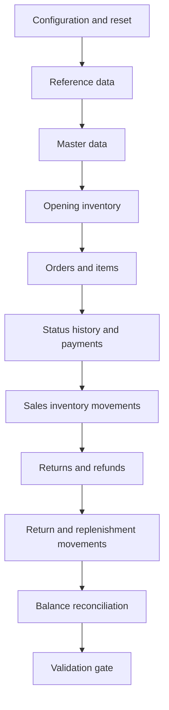

# Retail Sales & Inventory Intelligence Platform

## Synthetic Data Generation Strategy

| Document attribute | Value |
|---|---|
| Project name | Retail Sales & Inventory Intelligence Platform |
| Project version | 2.0 |
| Document | 09_Data_Generation_Strategy.md |
| Author | Akshay Aswani |
| Database | RetailIntelligenceDB |
| Platform | Microsoft SQL Server |
| Status | Approved generation baseline |
| Related documents | 01_Business_Requirements.md, 02_Business_Rules.md, 04_Database_Design.md, 08_Database_Design_Decisions.md |

---

## 1. Purpose

This document defines how the Version 2 synthetic retail dataset will be generated before implementation scripts are written. The strategy produces connected, realistic and reproducible operational data for SQL analysis, validation, performance testing and a multi-page Power BI portfolio dashboard.

The generator must simulate business processes rather than populate each table independently. Orders, status transitions, payments, returns, refunds and inventory movements must form one internally consistent transaction story.

## 2. Generation objectives

The generated dataset must:

1. Contain no real customer, employee, payment or credential information.
2. Produce the same baseline output from the same seed and configuration.
3. Respect all primary, foreign, unique, check and lifecycle rules.
4. Cover the fixed reporting period without future-dated transactions.
5. Create realistic seasonality, concentration and operational variation.
6. Preserve exact financial reconciliation within ₹0.01.
7. Preserve exact inventory reconciliation by product and store.
8. Include deliberate but valid edge cases for analytical testing.
9. Generate sufficient volume for indexing and performance demonstrations.
10. Support Power BI narratives that are explainable but not artificially perfect.

## 3. Data classification and disclosure

All generated data is classified as **synthetic portfolio data**.

- Names, emails, phone numbers, addresses and references must be fictional.
- Payment transaction references must not resemble usable credentials or card numbers.
- No copied production dataset or confidential employer information may be used.
- Repository documentation and dashboards must state that business findings are based on synthetic data.
- City, category and brand-like labels may be realistic, but generated transactions do not represent actual company performance.

Recommended disclosure:

> This project uses reproducible synthetic data created for portfolio demonstration. All people, transactions and business outcomes are fictional.

## 4. Fixed reporting period

```text
Start date: 01 July 2023
End date:   30 June 2026
Duration:   36 complete calendar months
```

The period is fixed so that SQL output, validation results, screenshots and Power BI time-intelligence measures remain reproducible.

Rules:

- All order, payment, delivery, return, refund and movement timestamps must be on or before `2026-06-30 23:59:59`.
- An event derived from an order must not occur before its parent event.
- Orders near the end date may legitimately remain open, pending payment or in transit.
- The analytical Date dimension will cover at least the complete reporting period.
- Indian financial-year attributes will use 1 April through 31 March.

## 5. Baseline scale

### 5.1 Required master and transaction volumes

| Entity | Baseline target | Accepted range |
|---|---:|---:|
| Stores | 20 | Exactly 20 |
| Employees | 100 | Exactly 100 |
| Customers | 10,000 | Exactly 10,000 |
| Suppliers | 50 | Exactly 50 |
| Products | 500 | Exactly 500 |
| Sales orders | 100,000 | Exactly 100,000 |
| Sales-order items | 310,000 target | 250,000–400,000 |
| Payment attempts | 108,000 target | 100,000–120,000 |
| Product returns | 10,000 target | 8,000–15,000 |
| Return items | 13,000 target | 8,000–25,000 |
| Inventory balances | 7,000 target | 5,000–10,000 |
| Inventory movements | Derived | Expected 350,000–650,000 |

Event-table counts such as status history, refunds and inventory movements are derived from lifecycle outcomes and must not be forced to a target at the expense of consistency.

### 5.2 Dataset profiles

| Profile | Orders | Purpose |
|---|---:|---|
| `SMOKE` | 1,000 | Fast development and procedure testing |
| `DEMO` | 10,000 | Screenshots, walkthroughs and quick Power BI iteration |
| `BASELINE` | 100,000 | Portfolio release and validation evidence |
| `PERFORMANCE` | 1,000,000 | Optional query-plan and indexing benchmark |

All profiles use the same rules and distributions. Only configured volumes and, where required, batch sizes change.

## 6. Reproducibility design

### 6.1 Configuration parameters

All variable generation settings must be centralized rather than scattered through scripts.

| Parameter | Baseline value | Purpose |
|---|---:|---|
| `GenerationProfile` | `BASELINE` | Selects scale |
| `RandomSeed` | `20260921` | Reproducible pseudo-random sequence |
| `PeriodStartDate` | `2023-07-01` | Earliest transaction date |
| `PeriodEndDate` | `2026-06-30` | Latest transaction date |
| `StoreCount` | `20` | Store volume |
| `EmployeeCount` | `100` | Employee volume |
| `CustomerCount` | `10000` | Customer volume |
| `SupplierCount` | `50` | Supplier volume |
| `ProductCount` | `500` | Product volume |
| `OrderCount` | `100000` | Order volume |
| `ReturnWindowDays` | `30` | Standard return window |
| `FinancialTolerance` | `0.01` | Reconciliation threshold |
| `LoadBatchSize` | `10000` | Transaction batching target |

### 6.2 Deterministic randomization

SQL Server `RAND()` alone is not suitable for independent row-level randomness because repeated set-based expressions may share values and execution behavior may vary.

Use deterministic pseudo-random values derived from stable row numbers and the configured seed, for example:

```sql
ABS(CHECKSUM(CONCAT(@RandomSeed, ':ORDER:', SourceRowNumber)))
```

Rules:

- Use a different namespace token for each generated attribute or decision.
- Convert checksums safely to a nonnegative range without relying on `ABS` of the minimum integer edge case.
- Do not use `NEWID()` for baseline decisions that must reproduce exactly.
- Identity values may be generated by SQL Server, but relationships must be resolved through business keys or captured mappings.
- Ordering must be explicit whenever row sequence affects generated values.

### 6.3 Run metadata

Each generation execution should record:

- Run identifier
- Profile and seed
- Start and end timestamps
- SQL Server version
- Script/repository version when available
- Requested and inserted row counts
- Validation result
- Duration by stage
- Failure message if rolled back

## 7. Generation workflow



The next stage must not start after a critical failure. The baseline release is accepted only when the validation gate passes.

## 8. Script and dependency plan

Recommended generation scripts:

| Sequence | Script | Responsibility |
|---:|---|---|
| 10 | `10_Load_Reference_Data.sql` | Seed controlled lists and classifications |
| 11 | `11_Generate_Stores.sql` | Generate 20 stores |
| 12 | `12_Generate_Employees.sql` | Generate employees and manager hierarchy |
| 13 | `13_Generate_Customers.sql` | Generate synthetic customers |
| 14 | `14_Generate_Suppliers.sql` | Generate suppliers |
| 15 | `15_Generate_Products.sql` | Generate product catalogue and prices |
| 16 | `16_Generate_Opening_Inventory.sql` | Create stocked product-store combinations and opening movements |
| 17 | `17_Generate_Sales_Orders.sql` | Generate order headers and items |
| 18 | `18_Generate_Order_Lifecycle.sql` | Generate status paths and timestamps |
| 19 | `19_Generate_Payments.sql` | Generate connected payment attempts |
| 20 | `20_Generate_Returns_Refunds.sql` | Generate eligible returns, items and refunds |
| 21 | `21_Generate_Inventory_Movements.sql` | Generate sales, returns, restocks and adjustments |
| 22 | `22_Rebuild_Inventory_Balances.sql` | Reconcile current balance to ledger |
| 23 | `23_Run_Data_Quality_Checks.sql` | Execute acceptance validation |

The repository's final SQL numbering may reserve ranges for validation or object creation, but execution order must remain unambiguous and must match the master runner.

## 9. Reference-data generation

Reference rows are curated seed data, not random output.

### 9.1 Required controlled codes

| Reference table | Baseline codes |
|---|---|
| `ref.OrderStatus` | `PENDING`, `CONFIRMED`, `PROCESSING`, `SHIPPED`, `DELIVERED`, `CANCELLED`, `PARTIALLY_RETURNED`, `RETURNED` |
| `ref.PaymentMethod` | `CASH`, `UPI`, `CREDIT_CARD`, `DEBIT_CARD`, `NET_BANKING`, `WALLET` |
| `ref.PaymentStatus` | `INITIATED`, `PENDING`, `COMPLETED`, `FAILED`, `CANCELLED`, `PARTIALLY_REFUNDED`, `REFUNDED` |
| `ref.ReturnReason` | `DAMAGED`, `DEFECTIVE`, `WRONG_ITEM`, `NOT_AS_DESCRIBED`, `SIZE_OR_FIT`, `CUSTOMER_CHANGED_MIND`, `OTHER` |
| `ref.ReturnStatus` | `REQUESTED`, `APPROVED`, `REJECTED`, `RECEIVED`, `REFUNDED`, `CLOSED` |
| `ref.InventoryMovementType` | `OPENING_STOCK`, `PURCHASE_RECEIPT`, `SALE`, `SALE_CANCELLATION`, `CUSTOMER_RETURN`, `DAMAGE_WRITEOFF`, `ADJUSTMENT_IN`, `ADJUSTMENT_OUT`, `TRANSFER_IN`, `TRANSFER_OUT` |

### 9.2 Product hierarchy

Recommended baseline:

| Entity | Target | Distribution guidance |
|---|---:|---|
| Categories | 8 | Broad retail departments |
| Subcategories | 24–32 | Three to four per category |
| Brands | 35–50 | Mix of high, medium and low demand |
| Suppliers | 50 | Concentrated assignment with a long tail |

Every classification must have a stable code. Display names may resemble familiar retail concepts, but the generated commercial performance remains fictional.

## 10. Store generation

### 10.1 Location design

Generate 20 stores across a controlled set of Indian cities and regions so that geographic comparisons are meaningful.

Suggested distribution:

| Region | Store share | Approximate stores |
|---|---:|---:|
| North | 30% | 6 |
| West | 30% | 6 |
| South | 25% | 5 |
| East/Central | 15% | 3 |

### 10.2 Store characteristics

Each store receives deterministic attributes used by downstream distributions:

- Size tier: `Large`, `Medium`, `Small`
- Demand multiplier: approximately `0.65–1.50`
- Operational start date before its first order
- City and state
- Product-assortment breadth
- Opening-stock multiplier
- Assigned employees and manager

Target size mix:

| Size tier | Share | Demand behavior |
|---|---:|---|
| Large | 25% | Higher order count and catalogue breadth |
| Medium | 50% | Baseline behavior |
| Small | 25% | Lower order count and narrower assortment |

Store performance should vary, but no single store should dominate because of a generation defect. As a reasonableness control, one store should normally represent no more than 12% of all orders unless explicitly configured.

## 11. Employee generation

Generate exactly 100 employees and assign each to one primary store.

### 11.1 Role mix

| Role group | Target share |
|---|---:|
| Store managers | 20% |
| Senior sales associates | 20% |
| Sales associates | 45% |
| Inventory/operations staff | 15% |

Rules:

- Every store receives one manager after employees are created.
- A manager cannot report to himself.
- Reporting hierarchies must be acyclic.
- Hire date must be on or before the employee's first processed order.
- Terminated employees may process only orders dated on or before termination.
- Employee sales allocation should be weighted by role, active period and store demand.
- Employee names and emails must be synthetic and unique where populated.

## 12. Customer generation

Generate exactly 10,000 synthetic customers with controlled purchase behavior.

### 12.1 Customer value/frequency segments

| Segment | Customer share | Expected order contribution |
|---|---:|---:|
| High value / loyal | 10% | 30%–35% |
| Regular | 30% | 35%–40% |
| Occasional | 45% | 25%–30% |
| One-time / dormant | 15% | 5%–10% |

This creates a realistic long-tail pattern while ensuring all segments have analyzable volume.

### 12.2 Customer rules

- Registration date must be on or before the first order date.
- Inactive customers retain history but receive no orders after deactivation.
- Email and phone can be null according to controlled percentages.
- Populated email values must be unique.
- Loyalty points must be nonnegative and related to qualifying purchase activity.
- Customer home city may influence but must not completely determine store choice.
- No customer should receive an impossible number of orders due to a weighting error.

## 13. Supplier and product generation

### 13.1 Supplier concentration

Use a non-uniform supplier assignment:

| Supplier group | Supplier share | Approximate product share |
|---|---:|---:|
| Strategic | 20% | 50% |
| Standard | 50% | 40% |
| Niche | 30% | 10% |

This supports concentration-risk and supplier-performance analysis.

### 13.2 Product pricing

Generate 500 products with price bands appropriate to their category.

Rules:

- `CostPrice > 0` and `SellingPrice > 0`.
- Normal products should have a positive planned margin.
- Approximately 1%–3% may be documented loss-leader products.
- Selling price should be rounded to commercially plausible increments.
- Reorder level should reflect demand velocity and store assortment.
- Excess-stock level must be greater than or equal to reorder level.
- Inactive products remain in history but receive no new order items after deactivation.
- SKU and populated barcode must be unique.

### 13.3 Product-demand concentration

Use a long-tail demand curve:

| Product group | Product share | Expected unit-sales share |
|---|---:|---:|
| High demand | 20% | 55%–65% |
| Medium demand | 50% | 30%–40% |
| Low demand | 30% | 5%–10% |

Demand weights combine product popularity, category, price band, season, store assortment and controlled promotional effects.

## 14. Product-store assortment and opening inventory

Do not create all 10,000 possible product-store combinations automatically. A realistic assortment varies by store size and local demand.

| Store tier | Expected active-product coverage |
|---|---:|
| Large | 85%–95% of products |
| Medium | 65%–80% of products |
| Small | 45%–65% of products |

The expected baseline is approximately 7,000 `InventoryBalance` rows.

For every stocked combination:

1. Create an `OPENING_STOCK` movement.
2. Use a positive quantity based on expected demand and reorder level.
3. Derive or initialize the current balance from movements.
4. Ensure reserved quantity is initially zero.

Products cannot be sold from stores where they have no inventory relationship unless a valid restock movement first creates availability.

## 15. Order-date distribution

Generate exactly 100,000 orders across the fixed 36-month period.

### 15.1 Growth trend

Apply a moderate fictional business growth trend rather than equal monthly counts.

Recommended annualized order-volume pattern:

| Period | Share of all orders | Interpretation |
|---|---:|---|
| Jul 2023–Jun 2024 | 28% | Establishing baseline |
| Jul 2024–Jun 2025 | 33% | Growth year |
| Jul 2025–Jun 2026 | 39% | Mature higher-volume year |

The pattern is intentionally synthetic and must not be described as actual market growth.

### 15.2 Day-of-week effect

| Day group | Relative weight |
|---|---:|
| Monday–Thursday | `0.90–1.00` |
| Friday | `1.05` |
| Saturday | `1.25` |
| Sunday | `1.20` |

### 15.3 Seasonal effects

Apply documented monthly/event multipliers, with all multipliers normalized before allocation.

| Period | Suggested multiplier | Business story |
|---|---:|---|
| January | 0.95 | Post-holiday normalization |
| February–March | 0.90–0.95 | Softer demand |
| April–June | 0.95–1.05 | Category-dependent summer demand |
| July–August | 1.00–1.05 | Mid-year promotions |
| September | 1.10 | Festive build-up |
| October–November | 1.25–1.40 | Peak festive demand |
| December | 1.15 | Year-end demand |

Do not apply one multiplier identically to every category. For example, cooling products may peak in summer while gifting-oriented categories peak during festive periods.

### 15.4 Order timestamps

- Generate transactions during plausible store operating hours.
- Use a modest evening and weekend peak.
- Do not generate timestamps before store opening or after store closure.
- Preserve deterministic ordering when several lifecycle events occur on the same day.

## 16. Order and item generation

### 16.1 Item count per order

Recommended distribution:

| Unique items | Order share |
|---:|---:|
| 1 | 20% |
| 2 | 25% |
| 3 | 22% |
| 4 | 15% |
| 5 | 9% |
| 6 | 5% |
| 7 | 3% |
| 8 | 1% |

This produces an expected average of approximately 3.0 unique lines per order and keeps the result inside the required 250,000–400,000 range.

### 16.2 Quantity per item

| Quantity | Item-line share |
|---:|---:|
| 1 | 72% |
| 2 | 19% |
| 3 | 6% |
| 4–5 | 3% |

High-priced products should be more likely to have quantity one. Bulk quantities must remain within available store inventory.

### 16.3 Basket selection

Product selection combines:

- Store assortment
- Product demand weight
- Category affinity
- Customer segment
- Seasonality
- Available inventory
- Price band
- Controlled promotion factor

Within one order, the same `ProductID` cannot be selected twice.

### 16.4 Discount distribution

| Discount band | Item-line share |
|---|---:|
| 0% | 35% |
| Greater than 0% through 5% | 25% |
| Greater than 5% through 10% | 25% |
| Greater than 10% through 20% | 13% |
| Greater than 20% through 30% | 2% |

Discounts above 30% are excluded from the baseline unless explicitly assigned to a documented clearance or loss-leader scenario.

### 16.5 Tax rates

Assign a controlled tax rate by product category from the approved baseline set:

```text
0%, 5%, 12%, 18%, 28%
```

The tax rate is snapshotted on the order item. Generation logic must calculate amounts in this order:

```text
GrossAmount    = Quantity × UnitPrice
TaxableAmount  = GrossAmount − DiscountAmount
TaxAmount      = ROUND(TaxableAmount × TaxRate / 100, 2)
NetAmount      = TaxableAmount + TaxAmount
```

Header amounts must equal the sum of item components within ₹0.01.

## 17. Order lifecycle generation

Lifecycle outcomes are selected first; valid transition paths and timestamps are then generated.

### 17.1 End-of-period status targets

| Final status | Target share | Notes |
|---|---:|---|
| `DELIVERED` | 78.0% | Completed without accepted return |
| `CANCELLED` | 10.0% | Cancelled before shipment |
| `PARTIALLY_RETURNED` | 5.0% | At least one accepted returned item |
| `RETURNED` | 5.0% | Entire delivered quantity accepted for return |
| `SHIPPED` | 1.0% | Generated near reporting-period end |
| `PROCESSING` | 0.6% | Generated near reporting-period end |
| `CONFIRMED` | 0.3% | Generated near reporting-period end |
| `PENDING` | 0.1% | Generated near reporting-period end |

Targets may vary by up to ±0.5 percentage points after eligibility and reconciliation constraints are applied.

### 17.2 Valid paths

Examples:

```text
PENDING → CONFIRMED → PROCESSING → SHIPPED → DELIVERED
PENDING → CANCELLED
CONFIRMED → CANCELLED
PROCESSING → CANCELLED
DELIVERED → PARTIALLY_RETURNED
DELIVERED → RETURNED
```

Rules:

- Every status-history timestamp must be nondecreasing.
- The first history row may have a null `FromOrderStatusID`.
- Current status must equal the latest `ToOrderStatusID`.
- Cancelled orders cannot later be shipped or delivered.
- Delivered and returned orders require a delivered timestamp.
- Cancelled orders require a cancelled timestamp.
- Open statuses should be concentrated near the reporting-period end rather than spread unrealistically across three years.

## 18. Payment generation

### 18.1 Payment-method mix

| Method | Baseline share of attempts |
|---|---:|
| `UPI` | 35% |
| `CREDIT_CARD` | 20% |
| `DEBIT_CARD` | 16% |
| `CASH` | 15% |
| `NET_BANKING` | 8% |
| `WALLET` | 6% |

Allow method mix to vary modestly by year, customer segment, order value and store location.

### 18.2 Attempt outcomes

| Initial attempt outcome | Target share |
|---|---:|
| Completed | 88% |
| Failed | 8% |
| Pending/initiated at snapshot | 2% |
| Cancelled | 2% |

Most eligible orders should complete in one attempt. A controlled share of failed attempts should retry, creating approximately 100,000–120,000 total attempts.

Rules:

- Attempt numbers start at one within each order and are unique.
- Transaction references are unique when populated.
- Completed amount cannot exceed the order's payable net amount.
- Cancelled orders cannot retain an unrefunded completed payment.
- Failed, pending, initiated and cancelled attempts do not count as collected revenue.
- Returned payments may transition to `PARTIALLY_REFUNDED` or `REFUNDED` based on completed refunds.

## 19. Return generation

Returns may be generated only from delivered order items and within the configured 30-day window.

### 19.1 Return volume

Target approximately 10,000 return requests, representing a controlled subset of delivered orders. Product-level return propensity should vary by category, product, supplier and reason.

### 19.2 Return reasons

| Reason | Target share of requested return items |
|---|---:|
| `DAMAGED` | 20% |
| `DEFECTIVE` | 20% |
| `WRONG_ITEM` | 12% |
| `NOT_AS_DESCRIBED` | 14% |
| `SIZE_OR_FIT` | 15% |
| `CUSTOMER_CHANGED_MIND` | 16% |
| `OTHER` | 3% |

Reason mix should vary by category; `SIZE_OR_FIT`, for example, should not be distributed equally across all categories.

### 19.3 Return outcomes

| Outcome | Target share |
|---|---:|
| Fully accepted | 72% |
| Partially accepted | 10% |
| Rejected | 18% |

Rules:

- Requested quantity cannot exceed delivered quantity available for return.
- Accepted quantity cannot exceed requested quantity.
- Cumulative accepted quantity across requests cannot exceed delivered quantity.
- Rejected requests have zero accepted quantity and zero completed refund.
- Return item must belong to the return header's original order.
- Reusable status is determined only after receipt/inspection.
- Damaged and defective outcomes should have a lower reusable rate than changed-mind returns.

## 20. Refund generation

Generate refunds only for financially eligible accepted returns.

Rules:

- Every refund references both a completed payment and its related return request.
- Payment and return must belong to the same order.
- Refund amount follows the original item's proportionate price, discount and tax treatment.
- Cumulative completed refunds cannot exceed completed payment amount.
- Cumulative refund amount cannot exceed eligible accepted return value.
- Partial returns may create one or more partial refund events.
- A small controlled share of refund events may be pending or failed at the reporting snapshot.
- Refund references are unique when populated.

Suggested refund-status outcome:

| Status | Target share |
|---|---:|
| `Completed` | 94% |
| `Pending` | 4% |
| `Failed` | 2% |

## 21. Inventory movement generation

Every change in stock must create an `InventoryMovement` record.

### 21.1 Required movement scenarios

| Movement type | Direction | Generation source |
|---|---:|---|
| `OPENING_STOCK` | +1 | Initial stocked product-store combination |
| `PURCHASE_RECEIPT` | +1 | Replenishment rule |
| `SALE` | -1 | Fulfilled/delivered sales item |
| `SALE_CANCELLATION` | +1 | Release/reversal when stock was previously reduced |
| `CUSTOMER_RETURN` | +1 | Accepted, received and reusable return item |
| `DAMAGE_WRITEOFF` | -1 | Damaged stock or non-sellable discovered stock |
| `ADJUSTMENT_IN` | +1 | Controlled stock correction |
| `ADJUSTMENT_OUT` | -1 | Controlled stock correction |
| `TRANSFER_IN` | +1 | Paired store transfer |
| `TRANSFER_OUT` | -1 | Paired store transfer |

### 21.2 Replenishment logic

- Calculate reorder need from projected stock and product-store reorder level.
- Generate purchase receipts before a sale would cause negative inventory.
- Vary replenishment lead time and quantity by supplier/product demand group.
- Replenishment quantities should normally raise stock above reorder level without creating universal excess stock.
- Preserve some valid low-stock, out-of-stock and excess-stock cases at period end for dashboard analysis.

### 21.3 Transfer logic

If store transfers are generated:

- Create paired `TRANSFER_OUT` and `TRANSFER_IN` movements.
- Use the same reference number.
- Keep product and quantity identical.
- Do not allow the source store to become negative.
- Maintain chronological consistency between dispatch and receipt.

### 21.4 Balance rebuild

For each product-store combination:

```text
CalculatedOnHand = SUM(Quantity × QuantityDirection)
```

The calculated result must exactly equal `InventoryBalance.QuantityOnHand`. Balance rows should be rebuilt or reconciled from the ledger after generation rather than trusted as independent random values.

## 22. Intentional valid edge cases

The baseline dataset should include analytically useful edge cases without violating integrity.

| Scenario | Target/coverage | Purpose |
|---|---:|---|
| Customer with exactly one order | Present in every run | One-time customer analysis |
| High-value loyal customer | At least 50 | RFM and concentration analysis |
| Product with no sales in latest 90 days | At least 20 | Slow-moving stock |
| Product sold at a loss | 1%–3% of products or qualifying lines | Margin investigation |
| Store below average growth | Multiple stores | Performance comparison |
| Product-store stockout | At least 1% of active combinations | Availability analysis |
| Product-store excess stock | At least 3% of active combinations | Working-capital analysis |
| Failed payment followed by success | At least 2,000 orders | Retry analysis |
| Multi-attempt payment with method change | Present | Payment behavior analysis |
| Partial return | At least 1,000 requests | Return/refund complexity |
| Fully returned order | Present across categories | Net-sales validation |
| Rejected return | At least 1,000 requests | Eligibility analysis |
| Non-reusable accepted return | Present | Inventory exclusion control |
| Open order near period end | Present in each open status | Snapshot reporting |
| Inactive master with historical activity | Present | Soft-retirement testing |

These are valid business scenarios. Invalid rows must not be inserted into the approved baseline merely to make a data-quality chart look interesting.

## 23. Negative-test dataset

Invalid data tests should run separately from the approved baseline, preferably inside transactions that are rolled back.

Required negative tests include attempts to create:

- Duplicate business codes
- Orphan foreign keys
- Duplicate product lines within an order
- Zero or negative quantities
- Discounts greater than gross amount
- Accepted return quantity greater than requested quantity
- Completed payment greater than payable order value
- Refund greater than completed payment
- Reserved inventory greater than on-hand inventory
- Invalid status transition
- Movement direction outside `-1` and `1`
- Duplicate validation test code within one run

The expected result is constraint/procedure rejection, not persisted bad data.

## 24. Financial reconciliation controls

The following controls must return zero exceptions:

| Control | Required result |
|---|---|
| Item gross | `GrossAmount = Quantity × UnitPrice` |
| Item discount | Between zero and gross amount |
| Item tax | Matches rounded taxable amount × tax rate |
| Item net | Gross − discount + tax |
| Order subtotal | Equals sum of item gross amounts |
| Order discount | Equals sum of item discounts |
| Order tax | Equals sum of item tax amounts |
| Order net | Equals sum of item net amounts |
| Completed payments | Do not exceed payable order value by more than ₹0.01 |
| Cancelled-order payment | No unrefunded completed amount remains |
| Accepted return | Does not exceed delivered quantity |
| Eligible refund | Matches accepted quantity and original item economics |
| Completed refund | Does not exceed eligible return/payment value |

All monetary equality checks use an explicit ₹0.01 tolerance where arithmetic sequence can create rounding differences.

## 25. Inventory reconciliation controls

The following controls must return zero exceptions:

- Negative on-hand quantity
- Negative reserved quantity
- Reserved quantity greater than on-hand quantity
- Negative available quantity
- Movement with zero/negative absolute quantity
- Movement direction outside `-1` and `1`
- Referenced sales movement with mismatched product
- Referenced return movement with mismatched product
- Reusable received return without a customer-return movement
- Non-reusable return that increases sellable stock
- Unpaired transfer reference
- Current balance different from cumulative signed movement quantity

## 26. Distribution reasonableness checks

Integrity alone does not guarantee believable data. The validation suite should warn—not necessarily fail—when distributions fall outside planned bands.

| Metric | Expected band |
|---|---:|
| Average unique order lines | 2.5–4.0 |
| Cancelled-order share | 8%–12% |
| Completed initial payment share | 84%–92% |
| Orders with return requests | 8%–15% |
| Accepted return-item share | 75%–85%, including partial acceptance |
| Weekend daily order rate vs weekday | 1.10–1.45 times |
| Top 20% products' unit share | 50%–70% |
| Top 10% customers' order/value share | 25%–45% |
| Largest store's order share | Less than 12% |
| Stocked product-store coverage | 50%–90% overall |
| Open-order share at snapshot | Less than 3% |

Warnings outside these bands require investigation and an explanatory note before release.

## 27. Performance and batching

- Prefer set-based number/tally sources over cursors and row-by-row loops.
- Generate large transaction sets in deterministic batches.
- Avoid disabling integrity permanently; if constraints are temporarily disabled for a controlled load, re-enable them with trust verification.
- Use `SET XACT_ABORT ON` and `TRY...CATCH` for multi-step transactional stages.
- Keep transactions bounded to avoid excessive log growth.
- Create essential constraints before generation; add selected analytical indexes after bulk load when justified.
- Capture row counts and execution duration by stage.
- Compare query plans and execution times before and after the index baseline.

## 28. Reset and rerun behavior

The generator must be rerunnable in a non-production portfolio database.

A safe reset process should:

1. Confirm the target database is `RetailIntelligenceDB` and the environment is approved for reset.
2. Delete/truncate generated rows in dependency order.
3. Preserve schema and controlled configuration unless a full rebuild is requested.
4. Reseed identities only when deterministic demonstration IDs are required.
5. Reload reference data idempotently.
6. Run generation from the configured seed.
7. Execute all critical validations.

The reset script must not contain an unrestricted destructive command or assume that the current database context is safe.

## 29. Error handling and transaction boundaries

Use a transaction boundary around each logically complete stage rather than one transaction for the entire 100,000-order build.

Examples:

- One transaction for reference seed data
- One transaction for a master-data entity
- One transaction per order batch including items and initial status history
- One transaction per payment batch
- One transaction per return/refund batch
- One transaction per inventory reconciliation stage

On failure:

- Roll back the affected stage.
- Record the stage, batch and error message.
- Do not continue into dependent stages.
- Leave the previous completed stage in a known state.
- Require a reset or documented resume point before retrying.

## 30. Acceptance criteria

The `BASELINE` dataset is approved only when all criteria pass:

### 30.1 Structural

- [ ] All required reference, master and transaction tables are populated.
- [ ] Exact baseline master counts are achieved.
- [ ] Order count equals 100,000.
- [ ] Order-item, payment and return counts fall within accepted ranges.
- [ ] All constraints are enabled and trusted.
- [ ] No orphan foreign keys or duplicate alternate keys exist.

### 30.2 Temporal and lifecycle

- [ ] All operational timestamps fall inside the approved period.
- [ ] Parent events occur before dependent events.
- [ ] Every status path follows the approved transition rules.
- [ ] Current order status matches the latest history record.
- [ ] Open orders occur only within a reasonable period-end window.

### 30.3 Financial

- [ ] All item and header formulas reconcile within ₹0.01.
- [ ] Completed payments do not exceed payable values.
- [ ] Cancelled orders have no unreversed completed collections.
- [ ] Return eligibility and refund values reconcile.
- [ ] Revenue measures do not include failed, cancelled or pending payments.

### 30.4 Inventory

- [ ] Inventory never becomes negative.
- [ ] Every stock change has a movement.
- [ ] Current balances equal the movement ledger.
- [ ] Transfers are paired.
- [ ] Only received reusable returns restore sellable stock.

### 30.5 Analytical quality

- [ ] All planned time periods, statuses, payment methods and return reasons have sufficient coverage.
- [ ] Concentration and seasonality checks fall within approved bands or are documented.
- [ ] The same seed and configuration reproduce the same control totals.
- [ ] SQL control totals are ready for later comparison with Power BI.

## 31. Required generation evidence

Commit the following evidence to the repository:

- Configuration summary with seed and reporting dates
- Script execution order
- Row-count summary by table
- Generation duration by stage
- Data-quality run ID and overall result
- Financial reconciliation summary
- Inventory reconciliation summary
- Distribution profile summary
- At least one deterministic rerun comparison
- Synthetic-data disclosure

Do not commit full generated transaction extracts when they make the repository unnecessarily large. Prefer reproducible scripts, small samples and documented control totals.

## 32. Portfolio narrative enabled

The planned data supports meaningful Power BI stories, including:

- Multi-year revenue and profit growth with seasonal peaks
- Store and regional performance variation
- Customer concentration, repeat behavior and RFM segmentation
- Product/category contribution and long-tail demand
- Payment-method adoption and retry/failure analysis
- Return reasons, supplier/product quality indicators and refund impact
- Stockout, low-stock, excess-stock and slow-moving inventory
- Employee productivity with fair store/time context
- Reconciliation from operational events to executive KPIs

Insights must be described as findings from the synthetic scenario, not as claims about a real retailer.

## 33. Implementation checklist

- [ ] Create a single configuration source.
- [ ] Implement deterministic pseudo-random helpers/patterns.
- [ ] Seed reference data through stable codes.
- [ ] Generate master data in dependency order.
- [ ] Generate product-store assortment and opening movements.
- [ ] Generate orders and unique items in batches.
- [ ] Generate valid status histories and timestamps.
- [ ] Generate connected payment attempts.
- [ ] Generate eligible returns and refunds.
- [ ] Generate all inventory movements.
- [ ] Rebuild/reconcile inventory balances.
- [ ] Capture generation metadata and row counts.
- [ ] Run critical validation and distribution checks.
- [ ] Save release control totals for Power BI reconciliation.

---

## 34. Next deliverable

The next project document should be:

```text
10_Testing_and_Validation_Strategy.md
```

It should define schema, constraint, lifecycle, financial, inventory, analytics, performance and Power BI reconciliation tests, including severity levels, expected outcomes and release-gate criteria.
