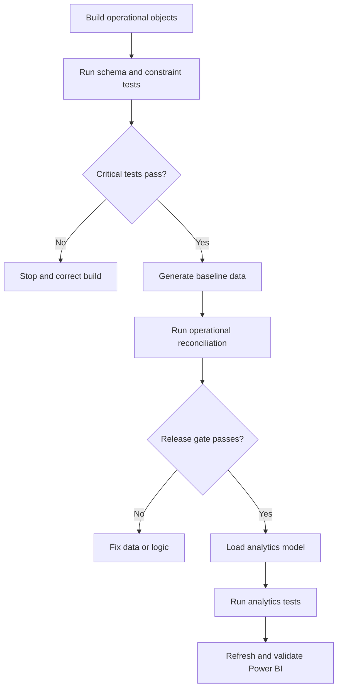

# Retail Sales & Inventory Intelligence Platform

## Testing and Validation Strategy

| Document attribute | Value |
|---|---|
| Project name | Retail Sales & Inventory Intelligence Platform |
| Project version | 2.0 |
| Document | 10_Testing_and_Validation_Strategy.md |
| Author | Akshay Aswani |
| Database | RetailIntelligenceDB |
| Platform | Microsoft SQL Server and Power BI |
| Status | Approved quality-assurance baseline |
| Related documents | 02_Business_Rules.md, 04_Database_Design.md, 07_ER_Diagram.md, 09_Data_Generation_Strategy.md |

---

## 1. Purpose

This document defines how Version 2 will prove that its database, generated data, analytical layer and Power BI model are correct. It converts business rules into repeatable assertions with explicit expected results, severity, diagnostics and release-gate behavior.

A query executing successfully is not evidence that the data is valid. Every mandatory test must calculate an exception count, compare it with an approved threshold, record evidence and fail the pipeline when the threshold is exceeded.

## 2. Quality objectives

Testing must demonstrate that:

1. All expected database objects exist with approved definitions.
2. Constraints are enabled, trusted and effective.
3. Generated rows respect entity grain and referential integrity.
4. Order, payment, return and inventory lifecycles are valid.
5. Financial values reconcile within ₹0.01.
6. Current inventory reconciles exactly to the movement ledger.
7. Analytical dimensions and facts preserve their declared grain.
8. Analytical joins do not multiply financial values.
9. SQL and Power BI return matching control totals.
10. Important queries perform acceptably at baseline scale.
11. Test results are retained as auditable release evidence.

## 3. Testing principles

- **Assert, do not merely inspect:** a mandatory test must return a deterministic pass/fail result.
- **Test the rule at the lowest reliable layer:** use constraints for row-level invariants and validation queries for cross-table rules.
- **Preserve diagnostic evidence:** failures must identify affected keys or grouped causes.
- **Separate valid baseline data from negative tests:** intentionally invalid rows are rolled back and never remain in the approved dataset.
- **Validate by grain:** every test states what one row represents.
- **Reconcile independently:** control totals should be calculated through a path independent of the object being tested.
- **Stop on critical failure:** analytics and Power BI refresh cannot proceed after a critical operational test fails.
- **Aggregate before joining unrelated facts:** prevent payment, return and item fan-out.
- **Re-run after material changes:** schema, generator, business-rule, index and DAX changes require targeted regression.

## 4. Validation layers

| Layer | Scope | Primary evidence |
|---|---|---|
| L1 Build | Database, schemas and objects | Metadata assertions |
| L2 Constraints | PK, FK, UQ, CK and DF behavior | Trusted metadata plus negative tests |
| L3 Reference/master | Codes, hierarchies, uniqueness and active periods | Exception queries |
| L4 Transactions | Order, payment and return grain/lifecycle | Cross-table assertions |
| L5 Financial | Item totals, order totals, collections and refunds | Reconciliation totals |
| L6 Inventory | Movement validity and current balance | Ledger reconciliation |
| L7 Audit | Validation-run completeness | Audit-table assertions |
| L8 Analytics | Dimensions, facts, grain and load coverage | Source-to-fact reconciliation |
| L9 Performance | Execution plans and runtime | Baseline benchmark report |
| L10 Power BI | Model, DAX, filters and visuals | SQL-to-DAX control matrix and QA checklist |

## 5. Severity and release behavior

| Severity | Definition | Allowed failures | Required action |
|---|---|---:|---|
| Critical | Can produce incorrect financial, inventory or structural results | 0 | Stop build/refresh; fix before release |
| High | Violates a mandatory business rule or materially distorts analysis | 0 | Block release |
| Medium | Data remains usable but quality or coverage is below target | Approved exception only | Investigate and document |
| Warning | Distribution or presentation concern | Allowed with review | Record rationale or tune generator |
| Info | Diagnostic/control observation | Not applicable | Retain for comparison |

An overall validation run is `Passed` only when:

- all Critical and High tests pass;
- no unapproved Medium failure exists;
- Warning results are reviewed and documented;
- test counts and status totals reconcile.

## 6. Test identification standard

```text
<Layer>-<Domain>-<Sequence>
```

Examples:

```text
SCH-TBL-001
DQ-ORD-004
FIN-PAY-003
INV-REC-001
BI-DAX-005
```

| Prefix | Test family |
|---|---|
| `SCH` | Schema and metadata |
| `CON` | Constraint behavior |
| `REF` | Reference data |
| `MST` | Master data |
| `DQ` | Transaction data quality |
| `LIF` | Lifecycle sequencing |
| `FIN` | Financial reconciliation |
| `INV` | Inventory integrity |
| `AUD` | Audit framework |
| `ANL` | Analytical model |
| `PERF` | Performance |
| `BI` | Power BI semantic/report validation |

Test codes are stable contracts. Do not reuse a retired code for a different assertion.

## 7. Standard test-result contract

Every automated validation must produce or persist the following fields:

| Field | Purpose |
|---|---|
| `ValidationRunID` | Groups all tests in one execution |
| `TestCode` | Stable test identifier |
| `TestName` | Human-readable assertion |
| `Severity` | Release impact |
| `ExpectedValue` | Approved threshold or value |
| `ActualValue` | Measured result |
| `ExceptionCount` | Number of violating rows/groups |
| `TestStatus` | `Passed` or `Failed` |
| `ExecutedDate` | Execution timestamp |
| `DiagnosticMessage` | Concise finding or pointer to details |

Critical tests use an allowed exception count of zero unless a documented rule explicitly states otherwise.

## 8. Assertion pattern

Recommended T-SQL pattern:

```sql
DECLARE @ExceptionCount BIGINT;

SELECT
    @ExceptionCount = COUNT_BIG(*)
FROM /* exception-producing query */ AS exceptions;

INSERT INTO audit.ValidationResult
(
    ValidationRunID,
    TestCode,
    TestName,
    Severity,
    ExpectedValue,
    ActualValue,
    ExceptionCount,
    TestStatus,
    ExecutedDate,
    DiagnosticMessage
)
VALUES
(
    @ValidationRunID,
    'DQ-ORD-001',
    'Confirmed orders contain at least one item',
    'Critical',
    '0 exceptions',
    CONVERT(VARCHAR(100), @ExceptionCount),
    @ExceptionCount,
    CASE WHEN @ExceptionCount = 0 THEN 'Passed' ELSE 'Failed' END,
    SYSDATETIME(),
    NULL
);

IF @ExceptionCount > 0
    THROW 51001, 'DQ-ORD-001 failed.', 1;
```

The actual implementation may use a reusable procedure, but it must preserve the same assertion semantics and diagnostics.

## 9. Execution workflow



## 10. Test environments and datasets

| Environment/profile | Purpose | Data behavior |
|---|---|---|
| Empty build | DDL and deployment testing | No business rows |
| `SMOKE` | Fast development regression | 1,000 orders |
| `BASELINE` | Portfolio release evidence | 100,000 orders |
| Negative-test transaction | Constraint/procedure rejection | Invalid attempts rolled back |
| `PERFORMANCE` | Optional scale benchmark | 1,000,000 orders |

Tests must identify which profiles they require. Full distribution and performance assertions do not apply to the `SMOKE` profile.

## 11. Schema and metadata test catalogue

| Test ID | Assertion | Expected | Severity |
|---|---|---:|---|
| SCH-DB-001 | Current database is `RetailIntelligenceDB` | Exact match | Critical |
| SCH-SCM-001 | Required schemas exist | 6 schemas | Critical |
| SCH-TBL-001 | Approved operational/audit tables exist | 25 tables | Critical |
| SCH-TBL-002 | No project table is unintentionally created under `dbo` | 0 tables | High |
| SCH-COL-001 | Required columns exist with approved data types and lengths | 0 mismatches | Critical |
| SCH-COL-002 | Mandatory columns are `NOT NULL` | 0 mismatches | Critical |
| SCH-PK-001 | Every approved table has one primary key | 25 tables | Critical |
| SCH-FK-001 | All approved foreign keys exist | 36 foreign keys | Critical |
| SCH-UQ-001 | Required alternate keys and filtered uniqueness exist | 0 missing | High |
| SCH-CK-001 | Required check constraints exist and are enabled | 0 missing/disabled | Critical |
| SCH-DF-001 | Required defaults are explicitly named and bound correctly | 0 mismatches | High |
| SCH-IDX-001 | Baseline indexes exist with expected key/include/filter definitions | 0 mismatches | High |
| SCH-NAM-001 | Object names follow approved naming conventions | 0 violations | Medium |
| SCH-TRU-001 | Mandatory FKs and checks are trusted | 0 untrusted | Critical |
| SCH-DUP-001 | No duplicate/overlapping index exists without justification | 0 unjustified | Medium |

## 12. Constraint negative-test catalogue

Each test runs within an explicit transaction and must roll back after confirming rejection.

| Test ID | Invalid operation attempted | Expected behavior | Severity |
|---|---|---|---|
| CON-PK-001 | Insert duplicate primary key | Rejected | Critical |
| CON-FK-001 | Insert orphan foreign key | Rejected | Critical |
| CON-UQ-001 | Insert duplicate business code | Rejected | Critical |
| CON-UQ-002 | Insert duplicate product within one order | Rejected | Critical |
| CON-UQ-003 | Insert duplicate payment attempt number for one order | Rejected | Critical |
| CON-UQ-004 | Insert duplicate product-store balance | Rejected | Critical |
| CON-CK-001 | Insert zero/negative item quantity | Rejected | Critical |
| CON-CK-002 | Insert discount above gross amount | Rejected/procedure failure | Critical |
| CON-CK-003 | Insert tax rate outside approved bounds | Rejected | High |
| CON-CK-004 | Insert accepted return quantity above requested quantity | Rejected | Critical |
| CON-CK-005 | Insert inventory direction outside `-1` and `1` | Rejected | Critical |
| CON-CK-006 | Set reserved quantity above on-hand quantity | Rejected | Critical |
| CON-DEL-001 | Delete referenced customer/product/store | Rejected | Critical |
| CON-DEF-001 | Omit `CreatedDate` during insert | Server default populated | High |
| CON-MLT-001 | Execute multi-row inventory operation | Every row handled correctly | Critical |

## 13. Reference-data tests

| Test ID | Assertion | Expected | Severity |
|---|---|---:|---|
| REF-COD-001 | Reference code is non-null and trimmed | 0 exceptions | High |
| REF-COD-002 | Reference codes are unique within their table | 0 duplicates | Critical |
| REF-NAM-001 | Reference names are non-null and trimmed | 0 exceptions | High |
| REF-ORD-001 | Sort order is valid and deterministic | 0 exceptions | Medium |
| REF-ACT-001 | Inactive values remain available to historical records | 0 orphans | Critical |
| REF-STS-001 | All approved order-status codes exist | Exact set | Critical |
| REF-PAY-001 | All approved payment methods/statuses exist | Exact set | Critical |
| REF-RTN-001 | All approved return reasons/statuses exist | Exact set | Critical |
| REF-INV-001 | All movement types have valid direction | 0 exceptions | Critical |
| REF-INV-002 | Movement types requiring a source are flagged correctly | 0 mismatches | High |

## 14. Master-data tests

| Test ID | Assertion | Expected | Severity |
|---|---|---:|---|
| MST-STR-001 | Store codes and names are unique | 0 duplicates | Critical |
| MST-STR-002 | Store closing date is not before opening date | 0 exceptions | Critical |
| MST-STR-003 | Store manager is assigned to the same active store | 0 exceptions | High |
| MST-EMP-001 | Employee codes are unique | 0 duplicates | Critical |
| MST-EMP-002 | Employee termination date is not before hire date | 0 exceptions | Critical |
| MST-EMP-003 | Employee does not manage himself | 0 exceptions | Critical |
| MST-EMP-004 | Employee manager hierarchy has no cycles | 0 cycles | Critical |
| MST-CUS-001 | Customer codes are unique | 0 duplicates | Critical |
| MST-CUS-002 | Populated customer emails are unique and trimmed | 0 duplicates/format issues | High |
| MST-CUS-003 | Loyalty points are nonnegative | 0 exceptions | High |
| MST-SUP-001 | Supplier codes/names are unique | 0 duplicates | Critical |
| MST-PRD-001 | SKU and populated barcode are unique | 0 duplicates | Critical |
| MST-PRD-002 | Product hierarchy resolves to one valid category | 0 exceptions | Critical |
| MST-PRD-003 | Cost and selling prices are positive | 0 exceptions | Critical |
| MST-PRD-004 | Excess-stock level is not below reorder level | 0 exceptions | High |
| MST-PRD-005 | New active product does not reference inactive master data | 0 exceptions | High |

## 15. Order-grain and transaction tests

| Test ID | Assertion | Expected | Severity |
|---|---|---:|---|
| DQ-ORD-001 | Every order references one valid customer, store, employee and status | 0 exceptions | Critical |
| DQ-ORD-002 | Confirmed or later non-cancelled orders contain at least one item | 0 exceptions | Critical |
| DQ-ORD-003 | No order contains duplicate product lines | 0 duplicates | Critical |
| DQ-ORD-004 | Order and item timestamps fall inside reporting period | 0 exceptions | Critical |
| DQ-ORD-005 | Customer registration date is on/before order date | 0 exceptions | High |
| DQ-ORD-006 | Employee is active on order date | 0 exceptions | Critical |
| DQ-ORD-007 | Employee's assigned store matches order store | 0 exceptions | Critical |
| DQ-ORD-008 | Product is active/eligible on order date | 0 exceptions | High |
| DQ-ORD-009 | Item quantity is positive | 0 exceptions | Critical |
| DQ-ORD-010 | Transaction unit cost and price are positive | 0 exceptions | Critical |
| DQ-ORD-011 | Order number is unique and correctly formatted | 0 exceptions | High |
| DQ-ORD-012 | Open orders occur only within configured period-end window | 0 exceptions | Medium |

## 16. Order lifecycle tests

| Test ID | Assertion | Expected | Severity |
|---|---|---:|---|
| LIF-ORD-001 | Every order has an initial status-history row | 0 missing | Critical |
| LIF-ORD-002 | First history row may have null From status; later rows may not | 0 exceptions | High |
| LIF-ORD-003 | Every transition follows the approved transition matrix | 0 invalid | Critical |
| LIF-ORD-004 | Status-change timestamps are nondecreasing | 0 exceptions | Critical |
| LIF-ORD-005 | Current order status equals latest history destination | 0 mismatches | Critical |
| LIF-ORD-006 | Cancelled order was never shipped/delivered afterward | 0 exceptions | Critical |
| LIF-ORD-007 | Delivered/returned order has delivered timestamp | 0 exceptions | Critical |
| LIF-ORD-008 | Cancelled order has cancelled timestamp | 0 exceptions | Critical |
| LIF-ORD-009 | Header lifecycle timestamps are chronologically valid | 0 exceptions | Critical |
| LIF-ORD-010 | Changed-by employee, when present, was active at change time | 0 exceptions | High |

## 17. Payment tests

| Test ID | Assertion | Expected | Severity |
|---|---|---:|---|
| DQ-PAY-001 | Payment references valid order, method and status | 0 exceptions | Critical |
| DQ-PAY-002 | Attempt numbers start at one and are sequential per order | 0 gaps/duplicates | High |
| DQ-PAY-003 | Populated transaction reference is unique | 0 duplicates | Critical |
| DQ-PAY-004 | Payment amount is positive | 0 exceptions | Critical |
| DQ-PAY-005 | Payment date is on/after order date | 0 exceptions | Critical |
| LIF-PAY-001 | Payment status follows approved transitions | 0 invalid | Critical |
| FIN-PAY-001 | Only completed attempts contribute to collected revenue | 0 misclassified | Critical |
| FIN-PAY-002 | Completed payment does not exceed payable order amount | 0 beyond ₹0.01 | Critical |
| FIN-PAY-003 | Cancelled order has no unrefunded completed payment | 0 exceptions | Critical |
| FIN-PAY-004 | Payment aggregation is performed before item/return joins | Control totals match | Critical |

## 18. Return and refund tests

| Test ID | Assertion | Expected | Severity |
|---|---|---:|---|
| DQ-RTN-001 | Return references a delivered original order | 0 exceptions | Critical |
| DQ-RTN-002 | Every non-rejected return contains at least one item | 0 exceptions | Critical |
| DQ-RTN-003 | Return item belongs to the header's original order | 0 exceptions | Critical |
| DQ-RTN-004 | Return item is unique within a return request | 0 duplicates | Critical |
| DQ-RTN-005 | Request date is within configured return window | 0 exceptions | High |
| DQ-RTN-006 | Accepted quantity is between zero and requested quantity | 0 exceptions | Critical |
| DQ-RTN-007 | Cumulative accepted quantity does not exceed delivered quantity | 0 exceptions | Critical |
| LIF-RTN-001 | Return status follows approved transitions | 0 invalid | Critical |
| LIF-RTN-002 | Approved/received/closed dates are chronologically valid | 0 exceptions | Critical |
| FIN-RFD-001 | Rejected return has zero completed refund | 0 exceptions | Critical |
| FIN-RFD-002 | Refund references an eligible completed payment | 0 exceptions | Critical |
| FIN-RFD-003 | Refund payment and return belong to the same order | 0 exceptions | Critical |
| FIN-RFD-004 | Completed refund does not exceed eligible return value | 0 beyond ₹0.01 | Critical |
| FIN-RFD-005 | Cumulative refund does not exceed completed payment | 0 beyond ₹0.01 | Critical |
| FIN-RFD-006 | Refund amount follows original discount/tax allocation | 0 beyond ₹0.01 | Critical |
| FIN-RFD-007 | Return/refund aggregation does not multiply through payment joins | Control totals match | Critical |

## 19. Financial reconciliation tests

| Test ID | Formula/assertion | Expected | Severity |
|---|---|---:|---|
| FIN-ITM-001 | `GrossAmount = Quantity × UnitPrice` | 0 beyond ₹0.01 | Critical |
| FIN-ITM-002 | `0 ≤ DiscountAmount ≤ GrossAmount` | 0 exceptions | Critical |
| FIN-ITM-003 | Tax equals rounded taxable amount × tax rate | 0 beyond ₹0.01 | Critical |
| FIN-ITM-004 | `NetAmount = Gross − Discount + Tax` | 0 beyond ₹0.01 | Critical |
| FIN-ORD-001 | Header subtotal equals summed item gross | 0 beyond ₹0.01 | Critical |
| FIN-ORD-002 | Header discount equals summed item discount | 0 beyond ₹0.01 | Critical |
| FIN-ORD-003 | Header tax equals summed item tax | 0 beyond ₹0.01 | Critical |
| FIN-ORD-004 | Header net equals summed item net | 0 beyond ₹0.01 | Critical |
| FIN-REV-001 | Cancelled orders are excluded from recognized revenue | 0 included | Critical |
| FIN-REV-002 | Recognized revenue uses delivered quantities and approved return adjustments | Control totals match | Critical |
| FIN-COG-001 | COGS uses snapshotted transaction unit cost | Control totals match | Critical |
| FIN-PRF-001 | Gross profit excludes pass-through tax | Control totals match | Critical |
| FIN-RND-001 | Aggregate first and round last unless line rule requires otherwise | 0 material mismatch | High |

## 20. Inventory tests

| Test ID | Assertion | Expected | Severity |
|---|---|---:|---|
| INV-BAL-001 | One balance exists per product-store combination | 0 duplicates | Critical |
| INV-BAL-002 | On-hand quantity is nonnegative | 0 exceptions | Critical |
| INV-BAL-003 | Reserved quantity is nonnegative and does not exceed on hand | 0 exceptions | Critical |
| INV-BAL-004 | Available quantity is nonnegative | 0 exceptions | Critical |
| INV-MOV-001 | Every movement has positive absolute quantity | 0 exceptions | Critical |
| INV-MOV-002 | Every movement direction is `-1` or `1` | 0 exceptions | Critical |
| INV-MOV-003 | Movement direction matches movement-type definition | 0 mismatches | Critical |
| INV-MOV-004 | Sale movement references the correct product/order item | 0 mismatches | Critical |
| INV-MOV-005 | Customer-return movement references the correct return item | 0 mismatches | Critical |
| INV-MOV-006 | Only received reusable returns restore sellable stock | 0 exceptions | Critical |
| INV-MOV-007 | Non-reusable returns do not increase sellable inventory | 0 exceptions | Critical |
| INV-MOV-008 | Transfer-out and transfer-in movements are paired | 0 unpaired | Critical |
| INV-MOV-009 | Append-only event rows were not destructively modified | 0 exceptions | High |
| INV-REC-001 | Balance equals cumulative signed movements by product/store | 0 mismatches | Critical |
| INV-REC-002 | Last movement date equals latest ledger event | 0 mismatches | High |
| INV-REC-003 | No sale causes interim stock below zero | 0 exceptions | Critical |

## 21. Synthetic-distribution tests

Distribution tests validate realism and coverage rather than exact business truth. Baseline thresholds come from `09_Data_Generation_Strategy.md`.

| Test ID | Metric | Expected band | Severity |
|---|---|---:|---|
| DQ-DST-001 | Average unique lines per order | 2.5–4.0 | Warning |
| DQ-DST-002 | Cancelled-order share | 8%–12% | Warning |
| DQ-DST-003 | Initial completed-payment share | 84%–92% | Warning |
| DQ-DST-004 | Orders with return requests | 8%–15% | Warning |
| DQ-DST-005 | Accepted return-item share | 75%–85% | Warning |
| DQ-DST-006 | Weekend vs weekday daily order rate | 1.10–1.45× | Warning |
| DQ-DST-007 | Top 20% products' unit share | 50%–70% | Warning |
| DQ-DST-008 | Top 10% customers' value share | 25%–45% | Warning |
| DQ-DST-009 | Largest store order share | Below 12% | Warning |
| DQ-DST-010 | Open-order share at snapshot | Below 3% | Warning |
| DQ-COV-001 | Every required year/month has transactions | 0 missing months | High |
| DQ-COV-002 | Every required status/method/reason appears sufficiently | 0 uncovered groups | Medium |
| DQ-RPR-001 | Same seed/configuration reproduces release control totals | Exact match | Critical |

## 22. Audit-framework tests

| Test ID | Assertion | Expected | Severity |
|---|---|---:|---|
| AUD-RUN-001 | Run start timestamp is populated | 0 missing | Critical |
| AUD-RUN-002 | Completed run has end timestamp | 0 missing | High |
| AUD-RUN-003 | Run status is valid for its completion state | 0 exceptions | Critical |
| AUD-RUN-004 | Total tests equal passed plus failed tests | 0 mismatches | Critical |
| AUD-RUN-005 | Header totals equal related result rows | 0 mismatches | Critical |
| AUD-RES-001 | Test code is unique within a run | 0 duplicates | Critical |
| AUD-RES-002 | Result status agrees with exception threshold | 0 mismatches | Critical |
| AUD-RES-003 | Failed critical test has diagnostic evidence | 0 missing | High |
| AUD-RES-004 | Validation procedure cannot label a failing assertion as passed | 0 mismatches | Critical |

## 23. Analytics-model tests

These tests apply after the `analytics` schema is implemented.

### 23.1 Dimension tests

| Test ID | Assertion | Expected | Severity |
|---|---|---:|---|
| ANL-DIM-001 | Every dimension has a unique surrogate key | 0 duplicates | Critical |
| ANL-DIM-002 | Required business key is unique for Type 1 dimensions | 0 duplicates | Critical |
| ANL-DIM-003 | Unknown member exists where required | Exactly 1 | High |
| ANL-DIM-004 | Date dimension contains every date in reporting period | 0 gaps | Critical |
| ANL-DIM-005 | Date attributes and Indian financial year are correct | 0 exceptions | Critical |
| ANL-DIM-006 | Sort columns are unique/valid for labels | 0 exceptions | High |
| ANL-DIM-007 | No fact foreign key is unresolved | 0 unknowns except approved cases | Critical |

### 23.2 Fact-grain tests

| Test ID | Assertion | Expected | Severity |
|---|---|---:|---|
| ANL-FCT-001 | `FactSales` has one row per qualifying order item | 0 duplicates/missing | Critical |
| ANL-FCT-002 | `FactPayments` has one row per payment event | 0 duplicates/missing | Critical |
| ANL-FCT-003 | `FactReturns` has one row per return item | 0 duplicates/missing | Critical |
| ANL-FCT-004 | `FactInventoryMovement` has one row per movement | 0 duplicates/missing | Critical |
| ANL-FCT-005 | Snapshot fact has one row per date/product/store | 0 duplicates | Critical |
| ANL-FCT-006 | Fact measures reconcile to operational source | 0 beyond tolerance | Critical |
| ANL-FCT-007 | Joining dimensions does not change fact row count | Exact match | Critical |
| ANL-FCT-008 | No direct fact-to-fact join is required | 0 relationships | High |

### 23.3 Fan-out tests

For each analytical query that combines facts:

1. Aggregate each fact independently to shared conformed dimensions.
2. Record its control total before the join.
3. Join only aggregated results or use the semantic model's shared dimensions.
4. Confirm the post-join total equals the pre-join control total.

Payment amounts must not be multiplied by order items, and return amounts must not be multiplied by payment attempts.

## 24. Performance test strategy

Performance tests run on the `BASELINE` profile after statistics and approved indexes are in place.

### 24.1 Benchmark queries

| Test ID | Workload | Target |
|---|---|---:|
| PERF-QRY-001 | Monthly sales trend across full period | Under 2 seconds warm-cache |
| PERF-QRY-002 | Product/category contribution with date filter | Under 3 seconds warm-cache |
| PERF-QRY-003 | Customer RFM source aggregation | Under 5 seconds warm-cache |
| PERF-QRY-004 | Store/employee performance | Under 3 seconds warm-cache |
| PERF-QRY-005 | Payment success and refund analysis | Under 3 seconds warm-cache |
| PERF-QRY-006 | Inventory reconciliation | Under 5 seconds warm-cache |
| PERF-QRY-007 | Return-rate analysis by product/supplier | Under 4 seconds warm-cache |

Targets are portfolio baselines, not universal service-level agreements; hardware and environment must be recorded.

### 24.2 Measurement protocol

- Record SQL Server version, hardware context and dataset profile.
- Run each query once to warm relevant pages, then execute at least three measured runs.
- Record median duration and logical reads.
- Capture the actual execution plan for tuning evidence.
- Check for scans, spills, key lookups, implicit conversions and cardinality errors.
- Compare before/after index results using the same parameters and cache protocol.
- Reject an index that duplicates another or imposes unjustified write cost.

### 24.3 Performance regression rule

A material regression is either:

- runtime increase greater than 25% with comparable conditions; or
- logical-read increase greater than 25%; or
- a new spill, severe estimate error or avoidable full scan on a core workload.

Material regressions require investigation before release.

## 25. Power BI semantic-model tests

| Test ID | Assertion | Expected | Severity |
|---|---|---:|---|
| BI-MDL-001 | Import mode is used for baseline | Exact match | High |
| BI-MDL-002 | Dimension key is unique on relationship's one side | 0 violations | Critical |
| BI-MDL-003 | Relationships are active and single-direction where designed | 0 mismatches | Critical |
| BI-MDL-004 | No unintended many-to-many relationship exists | 0 relationships | Critical |
| BI-MDL-005 | No direct fact-to-fact relationship exists | 0 relationships | Critical |
| BI-MDL-006 | Shared Date dimension is marked as date table | Passed | Critical |
| BI-MDL-007 | Technical keys/helper columns are hidden | 0 exposed | Medium |
| BI-MDL-008 | Business-critical KPIs use explicit measures | 0 missing | High |
| BI-MDL-009 | Measures have format, description and display folder | 0 missing | Medium |
| BI-MDL-010 | Sort-by columns are correctly configured | 0 mismatches | High |
| BI-MDL-011 | Auto date/time is disabled for governed model | Disabled | Medium |
| BI-MDL-012 | Model has no ambiguous filter path | 0 ambiguity | Critical |

## 26. SQL-to-Power-BI reconciliation matrix

Record SQL and DAX results under the same unfiltered full-period context, then repeat selected tests under year, store and category filters.

| Test ID | Control metric | SQL source | Tolerance |
|---|---|---|---:|
| BI-DAX-001 | Total orders | Distinct `SalesOrderID` | Exact |
| BI-DAX-002 | Delivered orders | Approved delivered population | Exact |
| BI-DAX-003 | Cancelled orders | Final cancelled status | Exact |
| BI-DAX-004 | Gross order value | Item gross for included orders | ₹0.01 |
| BI-DAX-005 | Recognized revenue | Delivered item value under KPI rule | ₹0.01 |
| BI-DAX-006 | Net revenue | Recognized revenue less approved return/refund adjustment | ₹0.01 |
| BI-DAX-007 | Discount amount | Included item discounts | ₹0.01 |
| BI-DAX-008 | Tax amount | Included item tax | ₹0.01 |
| BI-DAX-009 | COGS | Transaction cost under KPI rule | ₹0.01 |
| BI-DAX-010 | Gross profit | Net revenue excluding tax minus COGS | ₹0.01 |
| BI-DAX-011 | Units sold | Delivered units adjusted for accepted returns | Exact |
| BI-DAX-012 | Completed collections | Completed payments | ₹0.01 |
| BI-DAX-013 | Completed refunds | Completed refund events | ₹0.01 |
| BI-DAX-014 | Payment success rate | Completed attempts / valid attempts | 0.01 percentage point |
| BI-DAX-015 | Return rate by quantity | Accepted returned / delivered quantity | 0.01 percentage point |
| BI-DAX-016 | Inventory on hand | Current balance | Exact |
| BI-DAX-017 | Inventory value at cost | On hand × current cost | ₹0.01 |
| BI-DAX-018 | Active customers | Approved customer KPI population | Exact |

Any difference beyond tolerance is a Critical failure until explained and approved.

## 27. Power BI report-page QA

Apply these tests to every page:

- [ ] Page purpose and target user are documented.
- [ ] KPI titles match the KPI dictionary.
- [ ] Selected date/filter context is visible.
- [ ] Slicers use governed dimensions, not unrelated fact columns.
- [ ] Visual interactions are intentional.
- [ ] Cross-highlighting does not imply a false denominator.
- [ ] Drillthrough preserves expected filters.
- [ ] Reset-filters/navigation controls work.
- [ ] Empty selections show blank or a clear message, not a misleading zero.
- [ ] Percentage measures handle zero denominators safely.
- [ ] Tooltips add business context and use consistent measures.
- [ ] Currency, percentage, date and integer formats are consistent.
- [ ] Colors have consistent business meaning across pages.
- [ ] Tables and matrices do not expose technical keys.
- [ ] Visual totals match SQL controls for representative filter combinations.
- [ ] No visual displays confidential or real personal information.

## 28. Regression test triggers

| Change | Minimum regression scope |
|---|---|
| Table/column/constraint change | Schema, constraint and affected domain tests |
| Generator distribution change | Transaction, reconciliation, coverage and reproducibility tests |
| Lifecycle procedure change | Relevant lifecycle, financial and inventory tests |
| Index change | Schema/index and performance benchmark tests |
| Analytics load change | Dimension, fact, fan-out and source-reconciliation tests |
| DAX measure change | Metric SQL reconciliation plus impacted visuals |
| Relationship change in Power BI | Full semantic-model and cross-filter QA |
| Date logic change | Calendar, time intelligence and period-filter tests |
| KPI-definition change | Business-rule update, SQL control, DAX and README updates |

## 29. Defect management

Each failed mandatory test should create a defect record containing:

- Test ID and validation run ID
- Severity
- Affected object and business rule
- Exception count
- Representative keys/diagnostic query
- Root cause
- Corrective change
- Regression tests executed
- Resolution date and evidence

Do not change a threshold merely to make a failure disappear. Threshold changes require a documented business or design decision.

## 30. Release gates

### Gate 1 — Database build

- All required schemas/tables/columns exist.
- All PK, FK, UQ, CK and DF objects match design.
- Mandatory constraints are enabled and trusted.
- Negative constraint tests pass.

### Gate 2 — Operational dataset

- Baseline row counts meet approved targets/ranges.
- All Critical and High operational tests pass.
- Financial and inventory exception counts are zero.
- Reproducibility control totals match the release baseline.

### Gate 3 — Analytics layer

- Dimension keys are unique.
- Fact grains are preserved.
- Source-to-fact reconciliation passes.
- Fan-out controls pass.
- Core benchmark queries meet or have approved exceptions to targets.

### Gate 4 — Power BI release

- Semantic-model checks pass.
- SQL-to-DAX matrix passes within tolerance.
- Every report page completes the QA checklist.
- Screenshots and README values match the released dataset/model.

No later gate can override failure of an earlier gate.

## 31. Validation-run completion logic

At the end of a run:

```text
TotalTests  = count of ValidationResult rows
PassedTests = count where TestStatus = Passed
FailedTests = count where TestStatus = Failed
```

Set `OverallStatus` to:

- `Passed` when all release-blocking assertions pass and approved warnings are recorded;
- `Failed` when any Critical/High assertion fails or an unapproved Medium failure exists.

Populate `RunEndDate` only after totals and final status are committed.

## 32. Required release evidence

The repository should contain or document:

- Validation script inventory
- Latest baseline validation-run summary
- Exception counts by severity
- Financial reconciliation results
- Inventory reconciliation results
- Source-to-analytics control totals
- SQL-to-Power-BI reconciliation matrix
- Performance benchmark table and selected execution-plan screenshots
- Negative-test results showing constraint/procedure rejection
- Known approved warnings or limitations
- Release sign-off checklist

Large raw diagnostic exports should not be committed when concise summaries and reproducible queries are sufficient.

## 33. Recommended validation script structure

```text
sql/04_validation/
├── 20_Validate_Schema.sql
├── 21_Validate_Constraints.sql
├── 22_Validate_Reference_Data.sql
├── 23_Validate_Master_Data.sql
├── 24_Validate_Transactions.sql
├── 25_Validate_Financials.sql
├── 26_Validate_Inventory.sql
├── 27_Validate_Analytics.sql
├── 28_Run_Negative_Tests.sql
├── 29_Run_Performance_Benchmarks.sql
└── 30_Run_All_Validations.sql
```

`30_Run_All_Validations.sql` should orchestrate suites in release-gate order and stop after a blocking failure.

## 34. Final QA checklist

- [ ] Every Must-level business rule maps to an implementation object and/or test.
- [ ] Every Critical test has an expected value and diagnostic query.
- [ ] Validation results are persisted under one run ID.
- [ ] A failing assertion cannot print or store `Passed`.
- [ ] Invalid test rows are rolled back.
- [ ] Constraints remain enabled and trusted after data generation.
- [ ] Financial tolerance is consistently ₹0.01.
- [ ] Inventory reconciliation has zero exceptions.
- [ ] Analytical grains and relationships are validated.
- [ ] SQL and DAX controls use identical filter definitions.
- [ ] Performance comparisons use a documented protocol.
- [ ] Approved warnings are explained.
- [ ] README claims only capabilities that passed release gates.

---

## 35. Next deliverable

The next project document should be:

```text
11_KPI_Dictionary.md
```

It should define each business KPI with its purpose, formula, grain, date context, inclusions, exclusions, SQL control logic, DAX measure name, formatting and dashboard usage.
